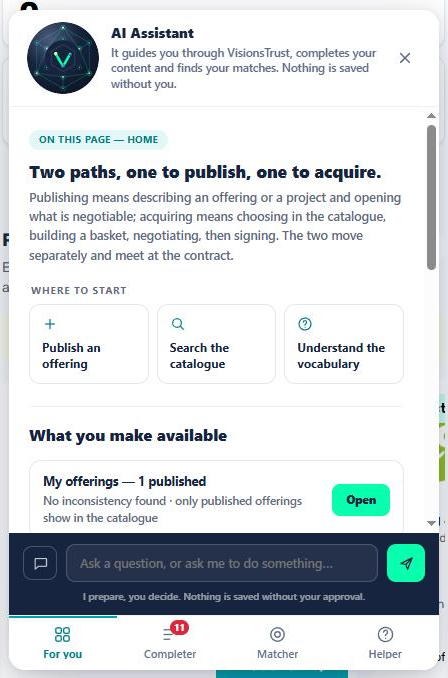

# AI Assistant

{{ app_name }} includes an AI assistant that helps you get things done in the catalogue: completing your offers and projects, finding partners, understanding the platform's vocabulary and knowing what to do next.

This page explains how the assistant works and how to find your way around it. Three companion pages go into detail:

- [Completing with AI](./assistant/completing.md): filling in offers, projects, resources and templates
- [Finding matches](./assistant/matching.md): searching the catalogue and reading match scores
- [Help and conversations](./assistant/help-and-conversations.md): documentation search, vocabulary, conversation history and limits

## What the assistant does

The assistant does four things, one per tab of its panel:

| Tab | What it is for |
|---|---|
| **For you** | What is waiting for you on the current page, and your conversation with the assistant |
| **Completer** | What is still missing in your offers, projects and resources, with proposals to fill it in |
| **Matcher** | Offers and projects that go with yours, and the reason for each match |
| **Helper** | Questions about the page, the words it uses, and a search in this documentation |

## How the assistant behaves

Four rules hold everywhere in the assistant.

**It knows where you are.** The assistant reads the page you are on (your dashboard, an offer's settings, a project, the basket, a negotiation) and adapts what it shows and what it proposes. You don't need to explain the context: ask "What should I do first on this page?" and it answers for the current page.

**It prepares, you decide.** The panel reminds you of it under the question field: *"I prepare, you decide. Nothing is saved without your approval."* Every value the assistant drafts and every action it suggests is shown to you first. Nothing changes until you click a button, and actions that cannot be undone ask for a confirmation.

**It works from a defined set of sources.** The assistant answers from the published catalogue, your own offers, projects, resources and contracts, the page you are on, and this documentation. When you give it a document or a link, it reads that too.

**It keeps the conversation going.** You can ask follow-up questions in the same conversation ("and for the pricing section?") without starting over. Your conversations are saved to your account.

!!! note
    The assistant uses a language model. Its proposals are a starting point: always review what it drafts, especially legal, pricing and personal data terms, before applying it. You remain responsible for what you publish.

## Opening the assistant

The assistant is available on every page once you are signed in. It appears as a **round floating button** in the bottom-right corner of the screen.

- A **red number** on the button tells you how many items are waiting for you (fields to complete, things to review).
- A **pulsing ring** means the assistant has a suggestion for your account.

Click the button to open the **assistant panel**. The panel stays open while you navigate and follows you from one page to the next. You can drag the button or the panel (by its header) to move it out of the way; double-click to put it back.

There are three other ways in:

- the **Complete with AI** button on forms (see [Completing with AI](./assistant/completing.md));
- the search bar on your home dashboard (*"Search or describe your need…"*); **Show analysis** on a result opens the assistant on that search;
- the small **Assistant** pop-ups that appear above the button (see [Assistant pop-ups](#assistant-pop-ups)).

!!! info
    If you don't see the floating button, the assistant is not enabled on your platform or is temporarily unavailable. The rest of the application works as usual.

## The assistant panel

From top to bottom, the panel shows:

1. A **header** with the title **AI Assistant**. While the assistant works, the line under the title tells you what it is doing (*"Reading and thinking…"*, *"Matching offers and projects…"*).
2. The **content** of the selected tab.
3. A **question field** (*"Ask a question, or ask me to do something…"*). Press Enter to send. The button on its left opens **Your conversations**.
4. The **tab bar**: **For you**, **Completer**, **Matcher**, **Helper**. A red number on **Completer** counts what is left to complete.

The conversation is kept when you switch tabs, and the tab you chose stays selected when you change page. A tab shows *"This tab is coming soon."* on pages where it has nothing to offer yet.

## The For you tab

**For you** is the assistant's home. It summarises the current page in a few blocks, for example:

- the drafts left to complete and what each is missing;
- the contracts waiting for your signature;
- the negotiations you need to answer;
- the pending requests to join your projects;
- the offers in the catalogue that fit your projects.

Each item comes with a button that takes you straight to the action: **Complete**, **Sign**, **Answer**, **Compare**, **Add to basket**, and so on. Depending on the button, the assistant:

- takes you to the right page and highlights the field to fill in;
- opens a **detail view** inside the panel (use the back arrow to return);
- opens the **Completer** or the **Matcher** on the item;
- asks a prepared question in the conversation;
- carries out the action for you, after a confirmation when it cannot be undone.

Some detail views contain a **My proposal** box (a value the assistant suggests, with its reason) or a **My reading** box (a short interpretation of your indicators, for example on your dashboard).

## What the assistant shows on each page

| Page | What you typically find |
|---|---|
| Home, My Dashboard | Where to start, drafts to complete, contracts to sign, a reading of your indicators |
| Catalogue | Offers compatible with your projects, suggested searches, comparing two offers or two projects |
| An offer or project in the catalogue | Which of your projects or offers match it, what yours are missing to fit, similar offers |
| My offers, My projects, My resources | What each draft is missing, consistency checks, requests waiting on you |
| Offer or project settings | What is left to fill in before publishing, what is fixed and what stays negotiable |
| Creating an offer or a project | What the current step still needs, and ways to fill it in from a text, a document or a link |
| Basket | Where your basket stands, how to assign offers to projects, what is left before sending |
| Negotiation | What is proposed compared with what you accept, and what is waiting on you |
| My contracts | Where each contract stands, and the contracts ready to sign |
| Exchange triggers, Tech Space, Profile settings | What is configured, what is missing, and the next check to run |

## Asking questions

You can ask the assistant anything related to the catalogue, in plain language, in English or French. The assistant answers in the language of the interface. A few examples:

- *"Find datasets about education in France"*
- *"Which of my projects could use this offer?"*
- *"Help me write the description of my offer"*
- *"What does 'service chain' mean?"*
- *"How do I set up a connector?"*
- *"What should I do first on this page?"*

Ask your question in the field at the bottom: the conversation opens in the **For you** tab. Answers are written text; they can contain links to pages of the application, which open when you click them.

When you search for offers, the assistant summarises the ones it found and why they are relevant. To compare results side by side, select them or add them to your basket, use the [Matcher](./assistant/matching.md).

### Suggested next steps

Under its latest answer, the assistant can show up to two **Suggested next steps**:

- **Open**: goes to a page mentioned in the answer.
- **Apply to the form**: writes the values it just drafted into the form you are on. This is offered on the offer and project creation pages. It asks for a confirmation, fills **only the empty fields**, and saves nothing: review the form, then save it yourself.

## Actions the assistant can carry out

Most buttons of the assistant take you somewhere or prepare a value. A few carry out a real action, exactly as the corresponding button of the page would:

- accepting or declining a request to join your project, approving a participant's exit;
- sending a join request for one of your offers;
- adding an offer to your basket, assigning basket lines to a project, removing a line;
- accepting a negotiation proposal;
- attaching a resource to an offer.

Actions that cannot be undone first show a confirmation bar above the question field, with **Cancel** and **Confirm**. For example: *"Accept the proposal as it stands? The negotiation closes and the contract goes to signature."*

## Assistant pop-ups

Small pop-ups labelled **Assistant** can appear above the floating button to tell you that something is ready or needs you: a proposal you asked for is ready, a contract is ready to sign, a new offer matches your project, your basket has lines without a project. Each has one button to act on it and closes by itself after a few seconds. Once you close a pop-up, the same information does not come back.

Two pop-ups help you get started:

- a **guided tour** in three steps (**For you**, **Completer**, **Matcher**) the first time you visit a screen. Click **Start**, or close it to skip;
- an offer of help when you stay on a form for a while without activity.

## Good practices

- **Be specific.** "Write a 3-line description for my mobility dataset aimed at public transport operators" gives better results than "describe my offer".
- **Work section by section.** Asking for one section at a time keeps proposals focused and easy to review.
- **Give it sources.** A document or a link to your website lets the assistant draft content that matches reality.
- **Always review before applying,** particularly pricing, personal data, legal basis and termination terms.

### Where to go from here

- [Completing with AI](./assistant/completing.md)
- [Finding matches](./assistant/matching.md)
- [Help and conversations](./assistant/help-and-conversations.md)
- [Create an offer](./registering-resources/creating-an-offer.md)
- [Create a project](./projects/creating-a-project.md)
