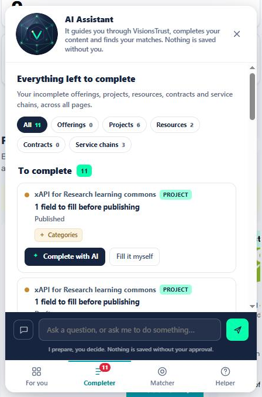
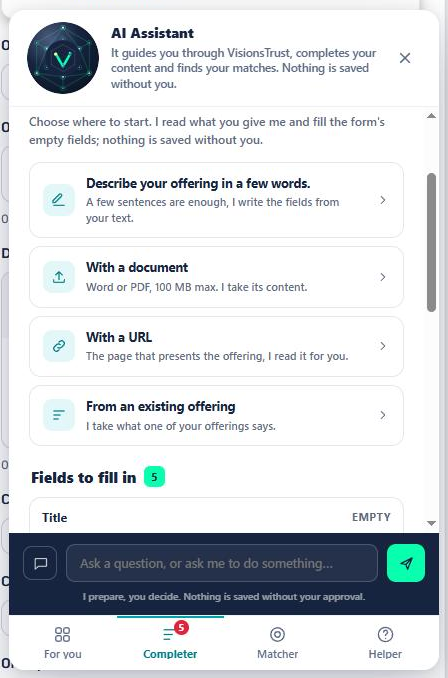

# Completing with AI

The [AI Assistant](../assistant.md) can tell you what is still missing in your offers, projects, resources and templates, and draft the missing content for you. This is the job of the **Completer** tab and of the **Complete with AI** buttons.

## The Complete with AI button

A **Complete with AI** button appears on the forms the assistant can help with. It opens the assistant panel on the **Completer** tab, focused on the section you are in.

| Where | Sections covered |
|---|---|
| Offer settings | Information, content, pricing, personal data, service levels, commitments, termination |
| Project settings | Information, governance, resources you need, additional clauses |
| Creating an offer or a project | Step 1 (information) |
| Data and software resource windows | The tab of the window you are on |
| Offer template and project template | The whole template |
| Basket, step 3 (*Adjust the baseline*) | The baseline table (see [Adjusting the basket baseline](#adjusting-the-basket-baseline-with-ai)) |

You can also open the **Completer** tab yourself from the assistant panel at any time.

## What the Completer tab shows

The Completer adapts to the page you are on.

| Page | What the Completer shows |
|---|---|
| Home and summary pages | **Everything left to complete** across your account: offers, projects, resources, contracts and service chains, with filters by type |
| My offers, My projects, My resources | One entry per incomplete item, with its progress and the fields left |
| Offer or project settings | One card per field of the item you are editing |
| Creating an offer or a project | Ways to fill in the current step |
| An offer or project in the catalogue | What your own projects or offers are missing to match it |
| Basket | The current step of the basket and what it still needs |
| A template tab, a resource window | The terms or fields not set yet |

In lists, each item offers two buttons: **Complete with AI** (opens the item with the Completer ready) and **Fill it myself** (takes you to the field).

## Does applying a proposal save it?

It depends on where you are. This is the most important thing to know before clicking.

| Where you apply | What happens |
|---|---|
| **Offer settings, project settings, list pages** (*Apply*, *Use the proposal*, *Apply the proposals*) | The value is **saved straight away** on your offer or project. A message confirms it (*"… has been updated."*) with an **Undo** button that restores the previous value. |
| **Creation forms, templates, resource windows, basket baseline, "Apply to the form" in the conversation** | The value is **written into the form only**. Nothing is saved until you use the page's own button (*Save*, *Next*, *Validate*). |

In both cases you can edit the value afterwards, and the assistant never applies anything without your click.

!!! tip
    On a published offer, an applied proposal is visible in the catalogue as soon as it is saved. Read it before you apply it.

## Completing an offer or project you are creating

On **step 1** of the creation of an offer or a project, the Completer offers four ways to start. The assistant reads what you give it and fills the **empty fields** of the form: name, short description, detailed description, category and location.

| Way in | How it works |
|---|---|
| **Describe your offering in a few words.** / **Describe your project in a few words.** | Describe your offer or project in a sentence or two, then send |
| **With a document** | Choose a Word or PDF document (100 MB maximum) |
| **With a URL** | Give the address of a web page, for example your product page |
| **From an existing offering** / **From an existing project** | Start from one of your own |

After reading, a card **Filled in by the assistant** lists what was written:

- fields marked *filled in* were empty and now hold the assistant's proposal;
- fields marked *your entry is kept* already had a value: the assistant shows its proposal next to it, and **Replace** swaps it in;
- one **Undo** puts the whole form back as it was.

Under **Fields to fill in**, each remaining field has a **Complete** button (the assistant writes that field alone) and a **Fill it myself** button (the cursor goes to the field).

Nothing is saved at this stage: review the form and continue with the page's own buttons.

!!! info
    If the assistant finds nothing to read in a document or a page, it says so and writes nothing. Only Word and PDF documents are read.

## Setting governance and clauses with a template

On **step 2** of creation (governance and clauses), the Completer shows **How to set your terms** with three choices:

| Choice | What it does |
|---|---|
| **Dataspace Template** (recommended) | The balanced terms most participants already accept, with the usual ones left open to negotiation |
| **My Offer Template** / **My Project Template** | Your own saved default values, reused from one offer or project to the next |
| **Configure each term manually** | One card per term, with the usual value proposed and **Apply** / **Undo** / **See the field** |

Pick a template, then **Apply this template**: the page fills the terms for you. **Learn more** asks the assistant to explain what the template changes. If the button is not available in the panel, choose the same method directly on the page.

You can also hand the assistant a document or a link at this step; it then answers in the conversation with the terms it suggests.

### Suggesting governance from a rulebook

When you create a project, step 2 also offers **Suggest from the rulebook**, directly on the page. If your project falls under a rulebook the assistant knows, it lists the rules by role and the principles that apply. Tick the ones you adopt, then **Apply**: the assistant writes the purpose and the benefit of the project from the rules you kept. **Undo** restores the form.

## Completing an existing offer or project

On the settings page of an offer or a project, the Completer shows your progress (*"N of M fields filled in"*) and one card per field:

- the field's current value, or *Not filled in*;
- **My proposal**, when the assistant has one, with the reason;
- **Apply** to save the proposal, then **Undo** if you change your mind;
- **Complete** to have the assistant write that field (name, descriptions, category, location);
- **See the field** to open the right tab of the page with the field highlighted.

When several proposals are ready, **Apply the proposals** saves them all at once.

On **My offers**, **My projects** and **My resources**, each incomplete item unfolds into its fields, with **Use the proposal**, **Undo** and **Write it with me**, which opens a conversation to draft the field together.

## Completing a resource

In a data or software resource window, the Completer lists what the resource is missing. **Propose with the agent** asks the assistant to draft the description and the schema description from what you already entered. **Use the proposal** writes it into the window; the resource is saved when you validate the window.

## Making your offers fit a project

On the page of a project in the catalogue, the Completer compares your offers with what the project is looking for and lists, for each one, what is missing to improve the match. On the page of an offer, it does the same for your projects. **Write it with me** opens a conversation to complete the missing element.

## Adjusting the basket baseline with AI

At step 3 of the basket (*Adjust the baseline*), **Complete with AI** asks the assistant to propose values for the baseline table: duration, renewal and usage terms, within what each provider accepts. The values are written into the table for you to review. **Undo the suggestion** restores the table. Nothing is sent until you confirm the basket at step 4.

At step 2 (*Assign to project*), the Completer can also propose how to distribute the offers of your basket across your projects (**Apply this distribution**).

## Why a proposal may not be available

| Message | What it means |
|---|---|
| *No proposal for this field yet.* | The assistant has not drafted this field. Use **Complete**, or fill it yourself. |
| *Analysis requested. The result will appear here once it is ready.* | The assistant is working in the background. The panel refreshes by itself, and a pop-up tells you when it is ready. |
| *Daily analysis limit reached* | Your account reached its daily number of analyses. Proposals come back the next day; you can still fill fields by hand. |
| *The agent is not available on this instance.* | AI drafting is not enabled on your platform. |

## Good practices for completion

- Start with a **source** (a document, a product page) rather than a blank field: proposals stay close to your real offer.
- Check **category** and **location**: the assistant chooses them from the platform's lists, and they drive [matching](./matching.md).
- Reread **pricing, personal data and termination** terms yourself. A template is a starting point, not legal advice.
- See also [how to describe your offers](../registering-resources/tips-and-tricks.md).
