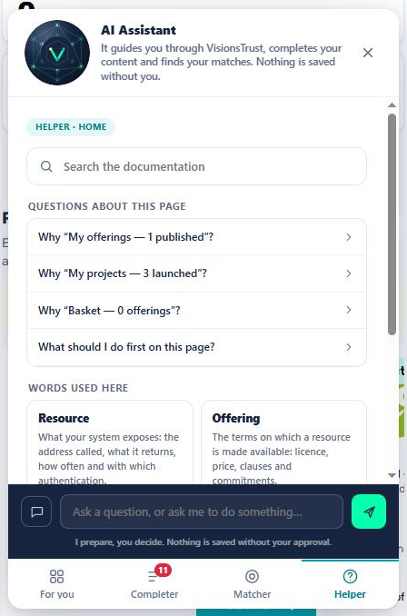

# Help and conversations

This page covers the **Helper** tab of the [AI Assistant](../assistant.md), your conversation history, and what to expect from the assistant: what it uses, its limits, and what to do when it does not answer.

## Getting help on the current page

The **Helper** tab gathers three kinds of help for the page you are on.

**Questions about this page.** The assistant prepares a few questions from what is waiting on the page, plus **What should I do first on this page?** Click one and the answer arrives in the conversation.

**Words used here.** A list of the terms used on the page, each with a one-line definition (for example *Orchestrator*, *Service chain*, *Negotiable term*, *Usage policy*). Click a word to have it explained in the context of the page. The [glossary](../../glossary.md) lists the main terms.

**Search the documentation.** See below.

## Searching the documentation from the assistant

In the **Helper** tab, type at least two characters in **Search the documentation** and press Enter. The matching sections of this documentation appear under *In the documentation*; click one to open it in a new tab.

**Ask the assistant** goes one step further: the assistant answers your question **from these pages only** and lists its **Sources**. If the documentation does not contain the answer, it tells you so instead of guessing.

## Your conversations with the assistant

Your conversations are saved to your account. The button to the left of the question field opens **Your conversations**:

- click a conversation to reopen it; your next question continues it;
- **New conversation** starts a fresh one;
- the bin icon deletes a conversation, after a confirmation. Deletion is permanent.

Searches made from the search bar of your home dashboard appear in the same list.

If the assistant answers while the panel is closed or while you are on another page, a pop-up tells you (*"I replied in …"*) with a button to open the conversation.

## What the assistant uses to answer

| Source | Used for |
|---|---|
| The page you are on | Adapting answers and proposals to what you are doing |
| Your account | The name of your organisation and your recent offers and projects, so that "my offer" means something |
| The published catalogue | Searches and matches |
| This documentation and the platform's glossary | Help answers |
| Documents and links you give it | Drafting your content from your own material |

The assistant does not use drafts of other participants: only published offers and projects are searched.

## Languages

The assistant answers in the language of the interface, English or French. Change the language of the application to change the language of the assistant.

## Limits to keep in mind

- **Analyses are limited per day.** Drafting proposals, reading documents, readings of your indicators and sourced answers from the documentation share a daily allowance per account. When it is reached, the assistant tells you (*"Daily analysis limit reached"*) and the allowance returns the next day. Everything else keeps working: the lists of what is missing, navigation, and filling fields by hand.
- **Answers arrive in one piece.** A complex question can take a little while. Wait for the answer before sending another message.
- **The assistant can be wrong.** It drafts from what it reads. Check facts, figures and legal terms.
- **Not available in the question field:** attaching a file (use the Completer's document option instead), stopping or regenerating an answer.

## When the assistant does not respond

| What you see | What to do |
|---|---|
| No floating button | The assistant is disabled on your platform or temporarily unavailable. Reload the page later; the application itself is unaffected. |
| *"I could not answer. Try again in a moment."* | The assistant could not be reached or took too long. Send your question again. |
| *"This tab is coming soon."* | The tab has nothing for this page, or its content could not be loaded. Try another page or reopen the panel. |
| *"The documentation could not be reached…"* | Open this documentation directly in your browser. |
| *"My reading is not available right now."* | The figures on the page stay correct; only the assistant's commentary is missing. |

### Where to go from here

- [AI Assistant overview](../assistant.md)
- [Completing with AI](./completing.md)
- [Finding matches](./matching.md)
