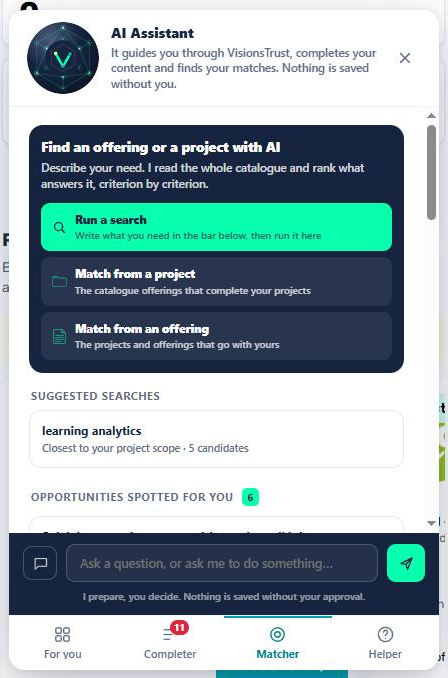
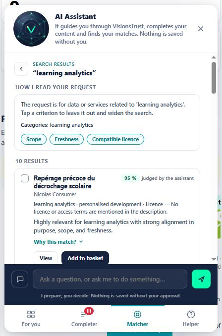

# Finding matches with the assistant

The **Matcher** tab of the [AI Assistant](../assistant.md) looks for good matches between your resources and the rest of the catalogue: offers that could feed your projects, projects that could use your offers, and offers that go well with yours.

## Three ways to start a search

The Matcher opens on a card **Find an offering or a project with AI** with three buttons.

| Button | What it searches |
|---|---|
| **Run a search** | What you describe in words. Type your need in the field at the bottom of the panel, then click the button. |
| **Match from a project** | The catalogue offers that complete one of your projects |
| **Match from an offering** | The projects that look for what you publish, and the offers that go with yours |

Below the card, the Matcher also shows:

- **Suggested searches**, prepared from your offers and projects;
- **Opportunities spotted for you**, such as a project looking for your kind of data, or an offer that fits one of your projects. **Ignore** hides an opportunity;
- **Best matches** from the catalogue;
- **Recent reports**, your previous searches.

## Reading the search results

At the top of the results, **How I read your request** shows how the assistant understood your search: a short summary and the criteria it extracted (categories, area, keywords, freshness, licence, type of offer).

Three criteria can be switched off to widen the search: **Scope**, **Freshness** and **Compatible licence**. Click a criterion to leave it out; click it again to bring it back. If no result remains, the assistant tells you which criterion set everything aside.

Each result card shows the offer or project, its organisation, a **score**, and a one-line reason.

## Understanding the match score

The score is shown as a percentage, followed by one of two mentions:

| Mention | How the score was obtained |
|---|---|
| **match** | Calculated from the information of the offer: its scope (categories), how recently it was updated, and its licence |
| **judged by the assistant** | The assistant read both descriptions and assessed how well they answer each other |

A criterion that cannot be assessed is left out of the calculation. When fewer than two criteria can be assessed, the card shows **To assess** instead of a percentage: not enough information is filled in to judge the match. Completing your offer or project gives a more reliable score (see [Making your offers fit a project](./completing.md#making-your-offers-fit-a-project)).

Click **Why this match?** on a card to see the detail, criterion by criterion. **Ask the assistant** then opens a conversation that explains the match in plain language.

!!! note
    A score is an aid to sort the catalogue, not a guarantee. Read the offer and its terms before you start a negotiation.

## Acting on a result

From a result card you can:

- open the offer or project;
- **Add to basket**: the offer joins your basket, and you can still remove it before sending your requests;
- tick several results, then **Find similar offerings** to start a new search from your selection.

## Search reports

Each search is kept as a **search report**, with the number of offers analysed and the number of strong matches. Find them under **Recent reports**, or **See all** for the full list grouped by period.

Opening a report **runs the search again** with the same criteria, so the results reflect the catalogue as it is today. If you change the criteria of a search, **Save this report** records the new version.

## Comparing offers or projects

From the catalogue, the assistant can compare two offers or two projects. Select two rows in the comparison view of the **For you** tab: the assistant sets them side by side (what they describe, freshness, price, commitments, conditions of access) and gives a verdict: they complete each other, they partly overlap, or the second adds nothing.

## Matches outside the panel

The same matches appear on your pages: your dashboard recommendations, and the matching sections of your projects, where **Offerings the assistant selected** lists the offers ranked for the project with the reason for each.

## How to get better matches

- Choose your **categories** carefully when you create an offer or a project: they are the first criterion of every match.
- Write a **description** that says what the offer contains and who it is for. The assistant reads it to judge the match.
- Keep your offers **up to date**: freshness is part of the score.
- For a project, fill in the **data and services you are looking for**.

Only published offers and projects are matched. A draft is never proposed to other participants.

### Where to go from here

- [Browsing the catalogue](../discovery/index.md)
- [Join a project](../negotiation/join-requests.md)
- [Completing with AI](./completing.md)
