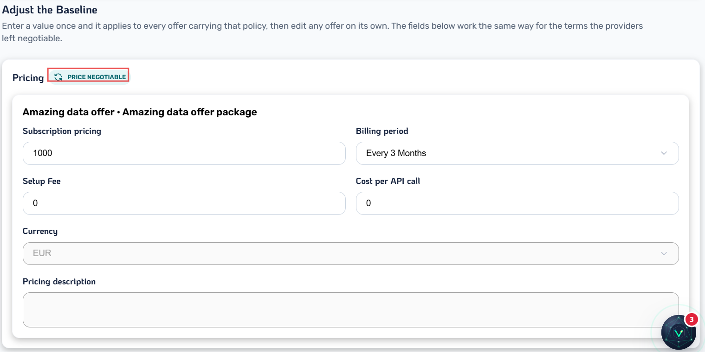
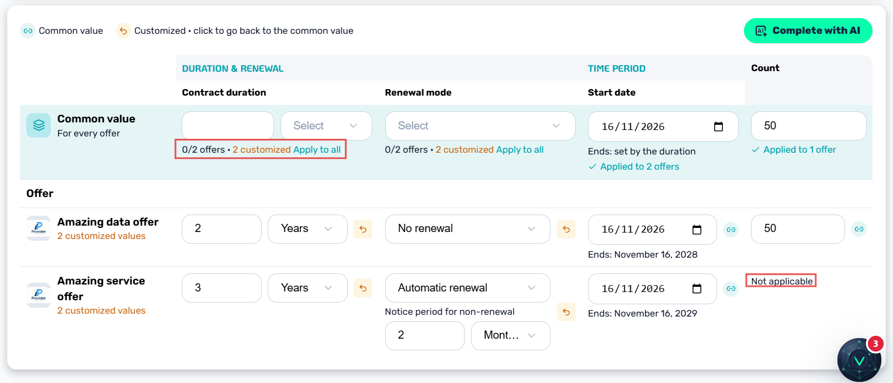

# Adjusting the baseline

This is step 3 of the [basket steps](./basket-steps.md).

The baseline is the set of terms you propose to the providers. It is the starting point of the negotiation. You can only adjust the terms that the providers left negotiable: the other terms are fixed by the provider.

## Pricing
When the provider allows the price of the selected package to be negotiated (**PRICE NEGOTIABLE** tag), the **Pricing** block is displayed and you can propose your own pricing:

- **Subscription pricing** and **Billing period**
- **Setup fee**
- **Cost per API call**
- **Pricing description**

The currency is set by the provider and cannot be changed.

When the selected package has a fixed price (**PRICE FIXED** tag), the **Pricing** block is not displayed: the price is set by the provider and you cannot propose another one.

## How it works
The other terms are displayed in a table:

- The **Common value** row applies to every offer in the basket. Under each value, a message shows how many offers it applies to, for example "Applied to 2 offers". When you customize offers, the message shows how many offers still use the common value and how many are customized, for example "0/2 offers • 2 customized". Click **Apply to all** to apply the common value to every offer.
- Below, each offer has its own row. You can change a value for a single offer, for example when one provider needs a different duration. The number of values you changed is displayed under the offer name, for example "2 customized values".

An icon next to each value of an offer shows where the value comes from:

- **Link icon**: the offer uses the common value.
- **Orange arrow icon**: the value has been customized for this offer. Click the icon to go back to the common value.

## Duration & renewal
Set how long the contract lasts and what happens when it ends:

- **Contract duration**: a number and a unit, such as 2 years.
- **Renewal mode**: for example **No renewal** or **Automatic renewal**.
- **Notice period for non-renewal**: appears when you choose **Automatic renewal**. It sets how long before the end of the contract a party must give notice if it does not want to renew.

## Time period
The time period is a usage policy that sets when the data can be accessed:

- **Start date**: the date the access begins.
- **End date**: calculated automatically from the contract duration and displayed under the start date. You cannot edit it.

## Count
Count is a usage policy that limits how many times the data can be used: the data must not be used more than a given number of times. Enter that maximum number of uses in the field. If an offer does not have this policy, **Not applicable** is displayed in its row.

Once the baseline is ready, click **Continue** to go to the last step: [Confirm & send](./basket-steps.md#step-4-confirm-send).