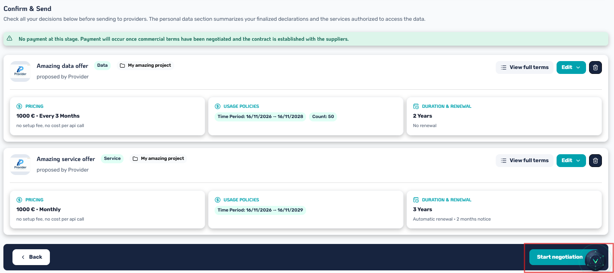

# Basket steps

Your basket guides you through 4 steps before your invitations are sent to the providers: review the basket, assign each offer to a project, adjust the baseline, then confirm and send.

A progress bar at the top of the basket shows where you are. The current step is marked **In progress** and the following step **Next step**. Completed steps show a check mark. Use **Continue** to move to the next step and **Back** to return to the previous one.

## Step 1: Review the basket
Check the offers in your basket before going further. Each offer shows its name, its type (Data or Service) and its provider, along with:

- **Pricing**: the price and billing period of the selected package, the setup fee and the cost per API call.
- **Usage policies**: the usage policies that apply to the offer, such as Time Period or Count.

For each offer, you can also:

- Click **View full terms** to open a read-only panel with all the terms of the offer, grouped by section: usage policies, duration and renewal, and service levels (SLA). Each term is tagged **Fixed** (set by the provider) or **Negotiable** (you can propose a value in step 3).
- Click **Change package** to switch to another package of the offer (see [Changing the package](#changing-the-package)). This link is only displayed when the offer has several packages.
- Click **Save for later** to move the offer to the **Saved for later** section.
- Click the bin icon to remove the offer from the basket.

### Changing the package
When an offer comes with several packages, **Change package** displays all the packages of the offer. Each package is shown as a card with its price and billing period, its setup fee, its cost per API call, a tag showing whether its price is fixed (**PRICE FIXED**) or negotiable (**PRICE NEGOTIABLE**), and its usage policies.

A package can carry the **RECOMMENDED** badge, marked with a star. The badge is set by the provider of the offer.

The package you are using is marked **Currently selected**. Click **Switch to this package** on another card to use it instead.

Once you have switched, the **Pricing** card of the offer shows the price and billing period of the new package.

## Step 2: Assign to project
Each offer must be assigned to a project.

- Choose a project for each offer from its drop-down list, or use **Same project for all** to assign every offer to the same project at once.
- If you don't have a suitable project yet, click **Create a new project**.

An offer with a project shows **Associated project**. An offer without a project shows **No project yet**. The **Continue** button becomes available once every offer has a project.

If an offer is already assigned to all your projects, the message "This offer is already assigned to all your projects, create a new one" is displayed. In the same way, **Same project for all** shows "No project can be assigned to all offers at once" when no project can receive every offer of the basket.

## Step 3: Adjust the baseline
Define the terms you want to propose to the providers. This step is described in [Adjusting the baseline](./adjusting-the-baseline.md).

## Step 4: Confirm & send
Check all your decisions before sending them to the providers. For each offer, the summary shows its project, its pricing, its usage policies, and its duration and renewal.

- **View full terms** shows all the terms of the offer.
- **Edit** opens a menu with two choices: **Edit project** takes you back to step 2, and **Edit terms** takes you back to step 3.
- The bin icon removes the offer from the basket.

When everything is correct, click **Start negotiation**. The message "Invitation sent, the provider will receive a notification to review the negotiation." appears and the basket is emptied.

Each provider can then accept your proposal, refuse it or make a counter-proposal. Learn more in the [negotiation process](../negotiation/negotiation.md).

