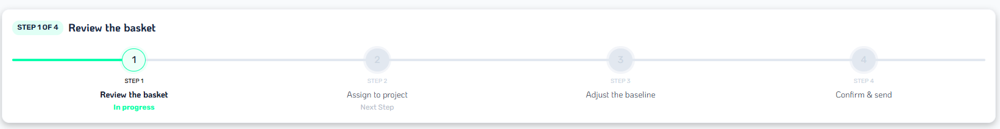
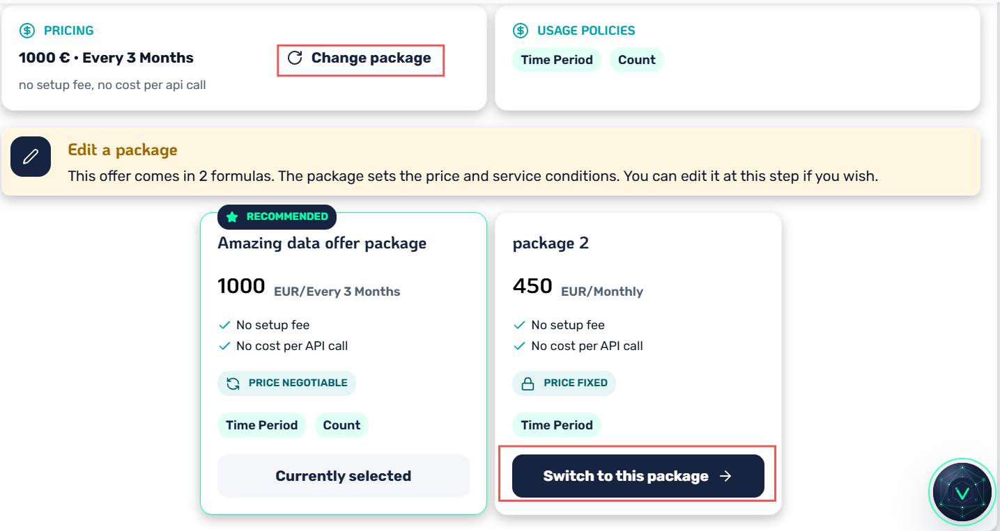
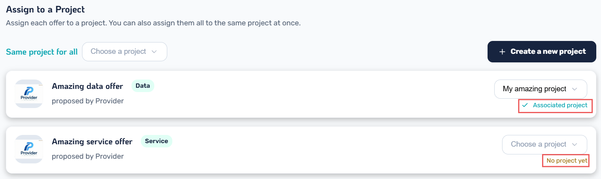

# Basket steps

Your basket guides you through 4 steps before your invitations are sent to the providers: review the basket, assign each offer to a project, adjust the baseline, then confirm and send. A progress bar at the top shows where you are. Use the **Continue** button to move to the next step and the **Back** button to return to the previous one.

## Step 1: Review the basket

Check the offers in your basket before going further. Each offer shows its provider, its pricing and its usage policies. Click the **View full terms** button to open a read-only panel with all the terms of the offer. Each term is tagged "Fixed" when it is set by the provider, or "Negotiable" when you can propose a value in step 3. See [Fixed and negotiable terms](./adjusting-the-baseline.md#fixed-and-negotiable-terms).

You can also save an offer for later or remove it from the basket with the bin icon.

### Changing the package

When an offer comes with several packages, you can change the one you selected:

1. Click the **Change package** button on the offer. All the packages of the offer are displayed as cards.
2. Compare them. Each card shows the price and billing period, the setup fee, the cost per API call, a tag showing whether the price is fixed (PRICE FIXED) or negotiable (PRICE NEGOTIABLE), and the usage policies. A star marks the package recommended by the provider, and "Currently selected" marks the one you are using.
3. Click the **Switch to this package** button on the package you want. The pricing of the offer then shows the price and billing period of the new package.

## Step 2: Assign to project

!!! info "Only published projects"

    The list only shows your published projects. A project that is still a draft does not appear in it.

Each offer must be assigned to a project:

1. Choose a project for each offer in its drop-down list, or use "Same project for all" to assign every offer to the same project at once.
2. If you don't have a suitable project yet, click the **Create a new project** button.
3. Click the **Continue** button, which becomes available once every offer has a project.

An offer without a project shows "No project yet".

You can also create a new project from this step. The project is created and published directly, and it is assigned to the offers of your basket right after its creation.

!!! info "Coming from a join request"

    When you add offers from a join request notification, they are already assigned to the project of the request. The basket then opens directly on step 3, "Adjust the baseline".

## Step 3: Adjust the baseline

Define the terms you want to propose to the providers. This step is described in [Adjust the baseline](./adjusting-the-baseline.md).

## Step 4: Confirm & send

Check all your decisions before sending them to the providers.

1. Check each offer. Click the **View full terms** button to see all its terms, or the **Edit** button to change your choices: "Edit project" takes you back to step 2 and "Edit terms" takes you back to step 3.
2. When everything is correct, click the **Start negotiation** button. The message "Invitation sent, the provider will receive a notification to review the negotiation." appears and the basket is emptied.

Each provider can then accept your proposal, refuse it or make a counter-proposal. Learn more in the [review a negotiation](../negotiation/negotiation.md).

## Saving an offer for later

In the first step, click the **Save for later** button of an offer to put it aside without removing it. It moves to the "Saved for later" list, under your basket. Click the **Move to basket** button to put it back in the basket.

When your basket is empty, the page also offers to add your saved offers to it.