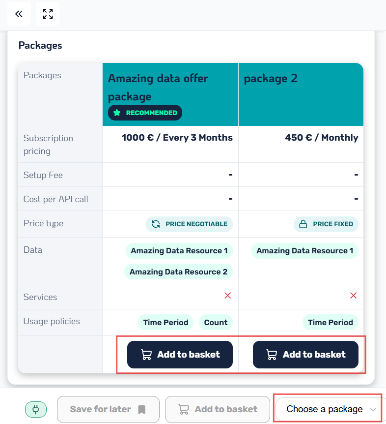

# Add an offer to the basket

## For Orchestrators

When you find offers in the catalogue that could serve one of your projects, the basket is where you prepare your invitations to their providers.

The basket enables you to gather offers, assign each of them to a project and define the terms you want to propose before starting a negotiation with the providers.

!!! warning "No payment at this stage"
    No payment happens in the basket. Payment occurs once the commercial terms have been negotiated and the contract is established with the providers.

1. Open an offer in the catalogue to display its details.
2. Check the packages of the offer. If the offer has a single package, it is selected automatically. If it comes with several packages, a table compares them side by side: their pricing, whether the price is negotiable, their resources and their usage policies. The package recommended by the provider is marked with a star.
3. Click the **Add to basket** button under the package you want. You can also use the **Choose a package** button at the bottom of the panel: the **Save for later** and **Add to basket** buttons stay disabled until a package is chosen.
4. The message "Offer added to basket" appears and the button becomes "Already in basket".

If you prefer to keep an offer aside, click the **Save for later** button instead.

The basket icon at the top of the page shows how many offers are in your basket. Click on it to open the basket.

### Saved for later

Offers you save for later appear in the "Saved for later" section, at the bottom of the basket. Click the **Move to basket** button to add an offer back to your basket. When your basket is empty, click the **Catalogue** button to browse offers.

Once your basket is ready, read on the [basket steps](./basket-steps.md).

## For Providers

When an orchestrator sends your offer from their basket, you receive a notification inviting you to review the proposal. You can then accept it, refuse it or make a counter-proposal. Learn more in the [review a negotiation](../negotiation/negotiation.md).