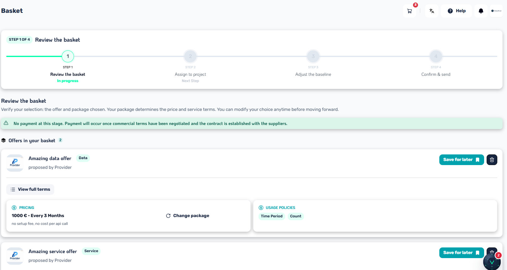
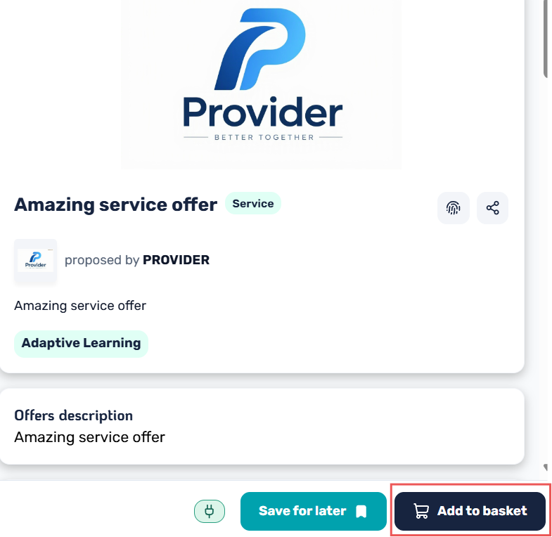

# Basket

## For Orchestrators
When you find offers in the catalogue that could serve one of your projects, the basket is where you prepare your invitations to their providers.

The basket enables you to gather offers, assign each of them to a project and define the terms you want to propose before starting a negotiation with the providers.

!!! warning "No payment at this stage"
    No payment happens in the basket. Payment occurs once the commercial terms have been negotiated and the contract is established with the providers.

### Adding an offer to the basket
1. In the **Catalogue**, open an offer to display its details.
2. Check the packages of the offer:
   - If the offer has a single package, it is selected automatically.
   - If the offer comes with several packages, click **Choose a package** and select one. **Save for later** and **Add to basket** stay disabled until you choose a package.
3. Click **Add to basket**. The message "Offer added to basket" appears and the button changes to **Already in basket**.
4. To keep an offer aside without adding it to the basket, click **Save for later**.

The basket icon at the top of the page shows how many offers are in your basket. Click it to open the basket.

For an offer with several packages, the list of packages is displayed under **Choose a package**.

### Saved for later
Offers you save for later appear in the **Saved for later** section, at the bottom of the basket. Click **Move to basket** to add an offer to your basket.

### Empty basket
When your basket is empty, click **Catalogue** to browse offers, or add offers from your **Saved for later** section.

Once your basket is ready, read on the [basket steps](./basket-steps.md).

## For Providers
When an orchestrator sends your offer from their basket, you receive a notification inviting you to review the proposal. You can then accept it, refuse it or make a counter-proposal. Learn more in the [negotiation process](../negotiation/negotiation.md).