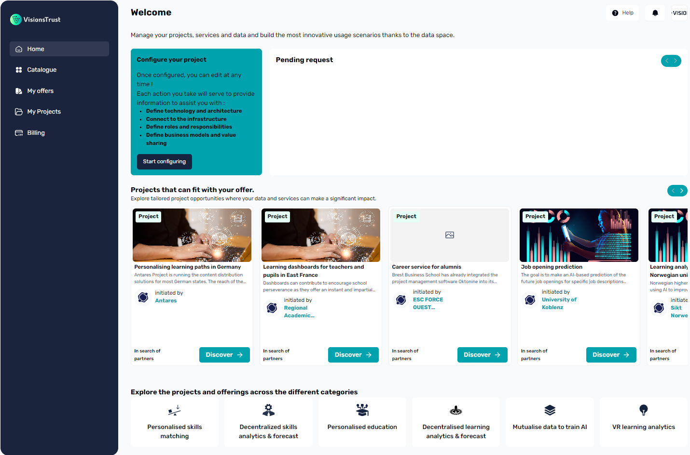

# Home

Your Home page is the center of operations for most actions you can do in the catalogue. It provides you with quick access to many different actions including:

- Following your activity in numbers
- Finishing your incomplete projects and offers
- Discovering projects that match with your existing offers
- Easy access to managing your projects & offers

## Your activity

At the top of the page, four numbers sum up your activity: the total revenue generated from your offers, your number of offers, the total number of requests on your offers, and the total number of connected source systems. Click the **See dashboard** button to see more details in [My Dashboard](./my-dashboard.md).

## Incomplete projects and offerings

This section lists your projects and offers that are not 100% complete, with their completion percentage, so that you know what is left to finish.

## Pending Requests

The pending requests section will display incoming requests that you received in order to join a specific project. Usually, you'll also receive a mail and be able to view this request in the notifications, but to make things simpler, it will also be displayed in a very visual way as soon as you open your Home page if you have any.

## Matching recommendations

The recommendations section displays projects that can match with the offers you have registered on the catalogue. It matches by analyzing the category of your offer, and finds projects that look for offers of your category. To refine these recommendations, fully configure your offer.

The cards work the same way as in the catalogue: selecting **Discover** opens a side-drawer where you can view more information, and click **Join this project** if you want to join that project.

## Manage your offers and projects

At the bottom of the page, the **Offers** and **Projects** buttons give you quick access to "My Offers" and "My Projects".

## Where to go from here

- [Create an offer](./registering-resources/creating-an-offer.md)
- [Create a project](./projects/creating-a-project.md)
- [Join a project](./negotiation/join-requests.md)