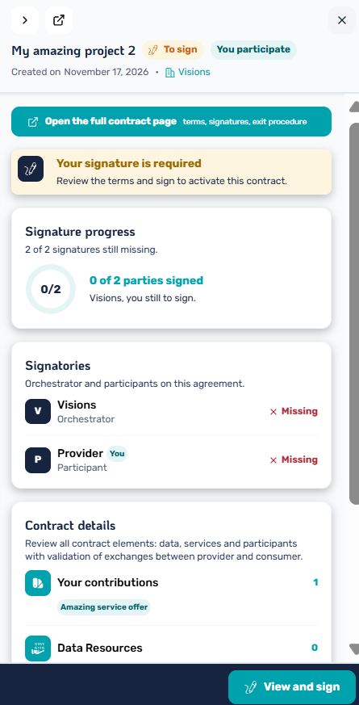

# All contracts

"All contracts" lists every contract of the overview. Use the tabs at the top to filter the list: "All", "As orchestrator" (the projects you orchestrate) and "As participant" (the projects you joined). Each tab shows its number of contracts. To filter by status instead, use the "STATUS" entries of the menu.

Each contract is shown as a card with:

- the name of the project and the status of the contract
- your role: "You orchestrate" or "You participate"
- the organisation of the orchestrator and the creation date
- the signature progress, for example "0/2 Signed", with the organisations that must sign

## Contract details

Click the **Details** button of a contract to open a side panel with a summary: the signature progress, the signatories and their status, the number of contributions and participants, and the contract ID, which you can copy.

To sign a contract, see [Sign a contract](./signing-a-contract.md).
