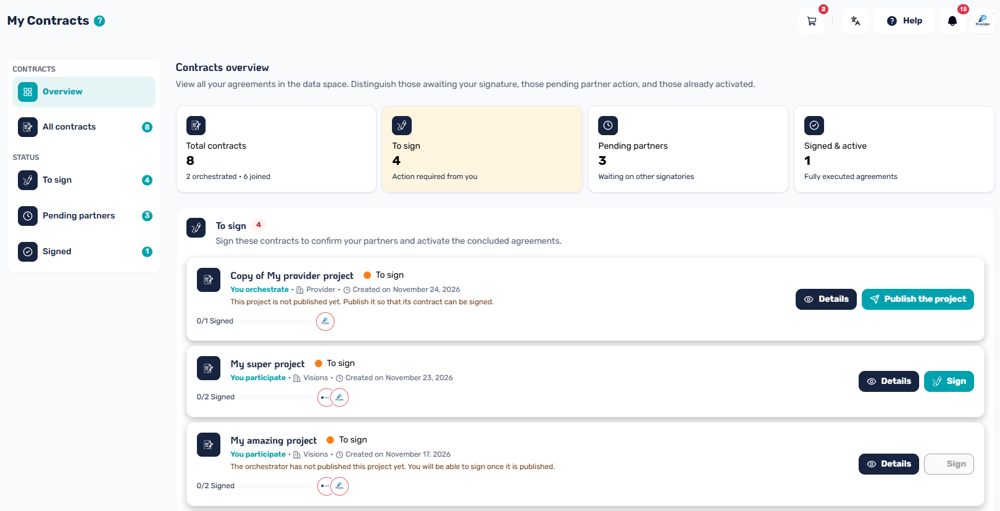

# My Contracts

A contract regulates the data exchanges of a project. For each project you orchestrate or join, a contract is generated from the project information, its participants and its clauses. The "My Contracts" page lets you follow all your agreements in one place.

To open it, click "My Contracts" in the navigation sidebar.

## The menu of "My Contracts"

The menu on the left of the page has three parts:

- "MY TEMPLATE": your "Offer template" and your "Project template" (see [Templates](../templates/overview.md)).
- "CONTRACTS": the "Overview" and "All contracts".
- "STATUS": your contracts sorted by status, "To sign", "Pending partners" and "Signed". Each entry shows its number of contracts.

## Overview

The overview shows your contracts at a glance, with four counters:

- **Total contracts**: all your contracts, with how many you orchestrate and how many you joined.
- **To sign**: the contracts waiting for your signature.
- **Pending partners**: the contracts waiting for the other signatories.
- **Signed & active**: the contracts signed by everyone.

Under the counters, the "To sign" list shows the contracts that need your signature, followed by your recent contracts.

To see the full list of your contracts, go to [All contracts](./all-contracts.md). To sign a contract, see [Sign a contract](./signing-a-contract.md).
