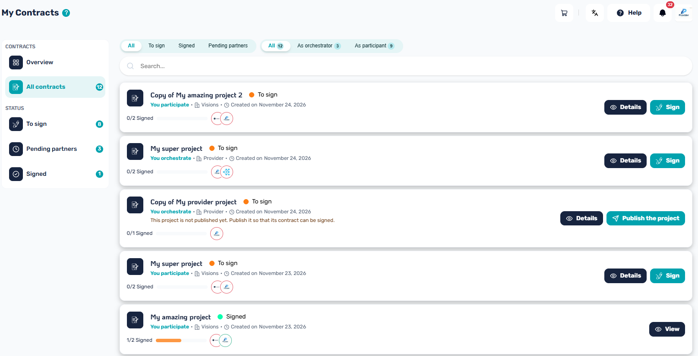
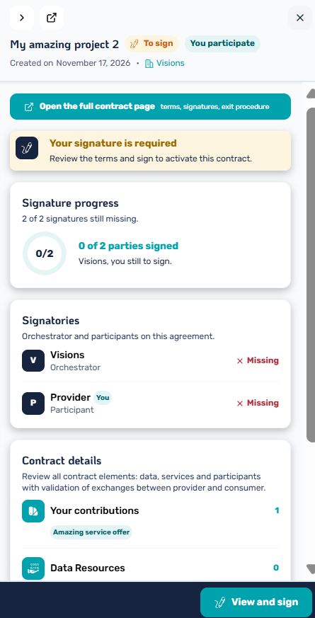

# My Contracts

A contract regulates the data exchanges of a project. For each project you orchestrate or join, a contract is generated from the project information, its participants and its clauses. The "My Contracts" page lets you follow all your agreements in one place.

To open it, click "My Contracts" in the navigation sidebar.

## The menu of "My Contracts"

The menu on the left of the page has two parts:

- **CONTRACTS**: the "Overview" and "All contracts".
- **STATUS**: your contracts sorted by status, "To sign", "Pending partners" and "Signed". Each entry shows its number of contracts.

## Overview

The overview shows your contracts at a glance, with four counters:

- **Total contracts**: all your contracts, with how many you orchestrate and how many you joined.
- **To sign**: the contracts waiting for your signature.
- **Pending partners**: the contracts waiting for the other signatories.
- **Signed & active**: the contracts signed by everyone.

Under the counters, the "To sign" list shows the contracts that need your signature, followed by your recent contracts.

To see the full list of your contracts, go to [All contracts](./overview.md#all-contracts). To sign a contract, see [Sign a contract](./signing-a-contract.md).

## All contracts

"All contracts" lists every contract of the overview. Use the tabs at the top to filter the list: "All", "As orchestrator" (the projects you orchestrate) and "As participant" (the projects you joined). Each tab shows its number of contracts. To filter by status instead, use the "STATUS" entries of the menu.

Each contract is shown as a card with:

- the name of the project and the status of the contract
- your role: "You orchestrate" or "You participate"
- the organisation of the orchestrator and the creation date
- the signature progress, for example "0/2 Signed", with the organisations that must sign

### Contract details

Click the **Details** button of a contract to open a side panel with a summary: the signature progress, the signatories and their status, the number of contributions and participants, and the contract ID, which you can copy.

To sign a contract, see [Sign a contract](./signing-a-contract.md).

## Contracts by status

The "STATUS" entries of the menu list your contracts by status: "To sign", "Pending partners" and "Signed". They are the same statuses as the counters of the [overview](#overview). Each entry shows its number of contracts.
