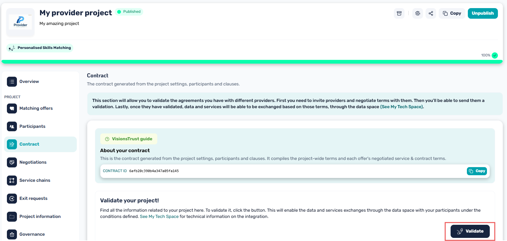

# Sign a contract

1. Click the **Sign** button of the contract. In "All contracts", the button is called **View and sign**. You can also use **Details**, then **View and sign**. The contract page of the project opens.
2. Review the contract: the project terms and, for each participant, its offers with their negotiated terms.
3. Click the **Validate** button.

Once all the participants have validated the contract, it is signed and active: data and services can be exchanged through the data space under the conditions defined.

!!! info "Project not published"

    If the project is not published, its contract cannot be signed yet. If you orchestrate the project, the card shows a **Publish the project** button instead of **Sign**: click it to open the project page, then publish the project (see [publishing a project](../projects/project-settings.md#understanding-project-publication)) and go back to "My Contracts". The **Sign** button is now available.

