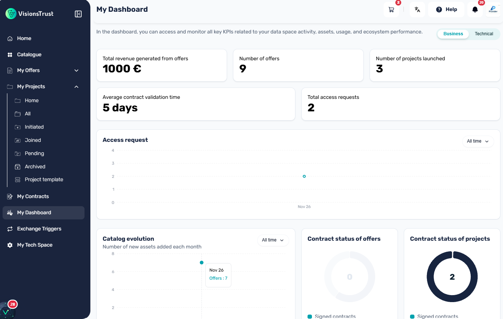

# My Dashboard

The "My Dashboard" page gathers the key figures of your activity on the data space: your assets, how they are used and how your ecosystem performs. To open it, click "My Dashboard" in the sidebar navigation menu, or click the **See dashboard** button of the [Home page](./dashboard.md).

The screenshot shows sample data.

The page has two tabs: **Business** and **Technical**.

## Business

The top of the tab shows five figures:

- **Total revenue generated from offers**
- **Number of offers**
- **Number of projects launched**
- **Average contract validation time**: the average time it takes for a contract to be validated, that is signed by all its participants.
- **Total access requests**: the number of access requests on your offers, that is the exchanges requested on them.

Below them, charts and tables give more details:

- **Access request**: the access requests on your offers over time.
- **Catalog evolution**: the number of new assets added each month, with the monthly rate and the comparison with the previous month.
- **Contract status of offers** and **Contract status of projects**: the number of signed contracts and of contracts pending validation.
- **Data offers by business domain** and **Service offers by business domain**: the number of your offers in each business domain.
- **Request by offers**: a ranking of your data assets by number of requests over the last 30 days. Switch between **Top 10** and **Top 50**.

The "Access request" and "Catalog evolution" charts have a list to choose the period: "All time", "Last day", "Last week", "Last month", "Last 3 months", "Last 6 months" or "Last year".

## Technical

The "Technical" tab shows the exchanges of your offers. The "Exchange by offers" table gives, for each offer, the total number of exchanges, the number of successful exchanges and the success rate.

!!! info

    The figures about exchanges (access requests, exchanges by offer) only appear if you have a connector and if exchanges have taken place on your offers.
