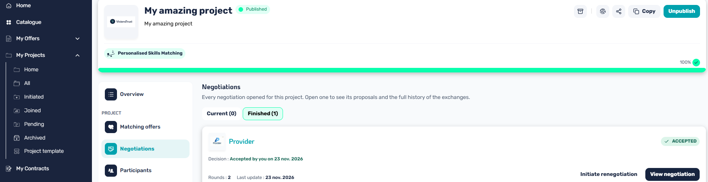

# Follow your negotiations

The "Negotiations" page of a project lists every negotiation opened for this project. To open it, go to your project and click "Negotiations" in the menu on the left.

## Current and finished negotiations

The page has two tabs, each with its number of negotiations:

- **Current**: the negotiations that are still in progress.
- **Finished**: the negotiations that have been concluded, accepted or declined.

Each negotiation is shown as a card with:

- the name of the provider, and the status of the negotiation (for example **ACCEPTED**)
- the decision, for example "Accepted by you on 10 nov. 2026"
- the number of rounds, and the date of the last update

A card in the "Current" tab shows "NEGOTIATION IN PROGRESS". When a participant has not answered yet, the **Resend notification to join** button sends them the notification again.

## Opening a negotiation

Click the **View negotiation** button of a card to see its proposals and the full history of the exchanges (see [Review a negotiation](./negotiation.md)).

## Restarting a finished negotiation

In the "Finished" tab, each card also has an **Initiate renegotiation** button. Use it to open the negotiation again: see [Restart a negotiation](./restarting-a-negotiation.md).
