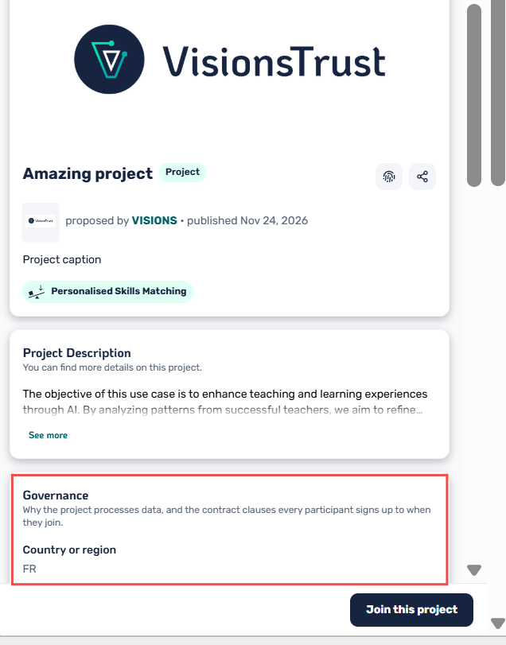

# Join a project

A join request is how a participant shows that they are interested in a project. It sends a notification to the orchestrator of the project, who reviews the request and can then start a negotiation with you.

## Sending a join request

To send a join request, you must have at least one published offer that can be used by the project. You cannot join a project without providing anything to it.

1. In the catalogue, open the "Projects" tab and click the **Discover** button of the project you are interested in. A panel opens.
2. Click the **Join this project** button at the bottom of the panel.

The message "Join request sent" confirms that your request is sent to the orchestrator of the project.

## After the join request

The orchestrator receives a notification and an email. When the orchestrator clicks the notification, the catalogue opens with only the offers of your organisation. It is then the orchestrator who chooses which of your offers to add to the project: the orchestrator adds them to the basket, which opens directly on the step "Adjust the baseline" because the project is already assigned, then starts a negotiation (see [Invite offers](./invitations.md)). You then review the proposal: see [Review a negotiation](./negotiation.md).
