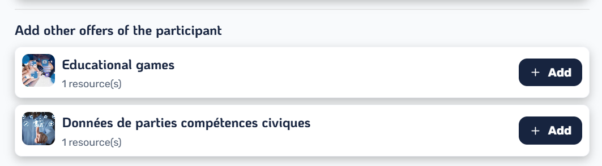
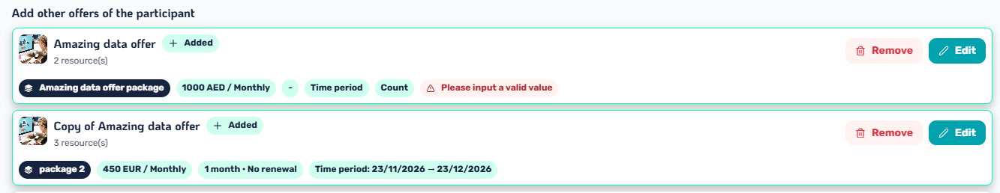

# Restart a negotiation

A finished negotiation can be opened again. This is useful when the terms need to change after a decision, for example the duration of the contract, or the package of an offer. Both sides can restart a negotiation, including one that was declined.

To restart a negotiation:

1. Open the "Negotiations" page of your project (see [Follow your negotiations](./following-negotiations.md)).
2. In the "Finished" tab, find the negotiation and click the **Initiate renegotiation** button. The page opens with the title "Renegotiate with ...", and a round number.
3. Change the values you want in the "COUNTER WITH" fields, counter with another package, or [add another offer](#adding-another-offer).
4. Click the **Send counter-offer** button.

The other side then answers as usual: see [Review a negotiation](./negotiation.md).

!!! info

    The screen is similar to the review page, but there is no **Accept all** or **Decline**: **Send counter-offer** is the only way to send your proposal. The other side is then notified and answers as usual.

## Adding another offer

During a renegotiation, you can add other offers of the same participant to the negotiation.

At the bottom of the page, the "Add other offers of the participant" list shows the other offers of this participant, with their number of resources.

1. Click the **Add** button next to the offer you want. The offer is added to the negotiation, with the mention "Added".
2. Fill in the values that the offer needs, such as the time period and the count. Until they are filled in, **Send counter-offer** stays disabled, and a message lists the missing values, for example "A valid value is required for: Time period, Count.". Click **Show the field** to go to them.
3. Click the **Send counter-offer** button.

To take an added offer out of the negotiation, click its **Remove** button.
