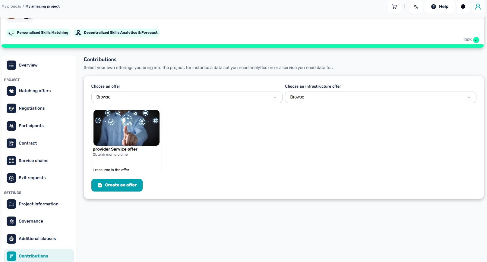
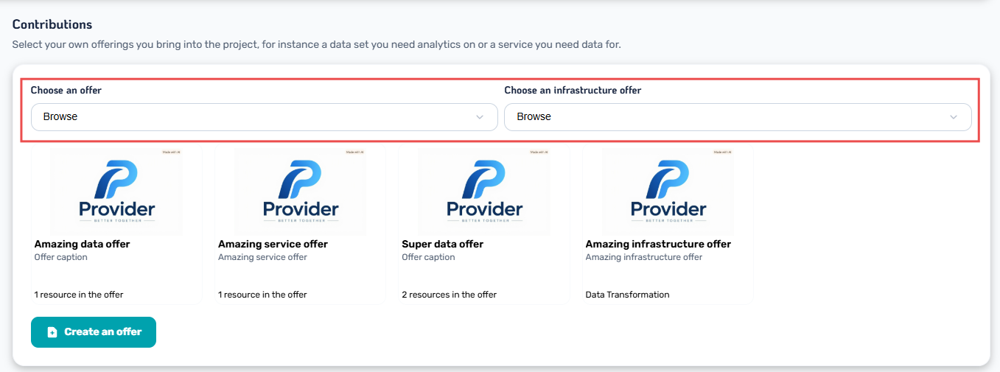
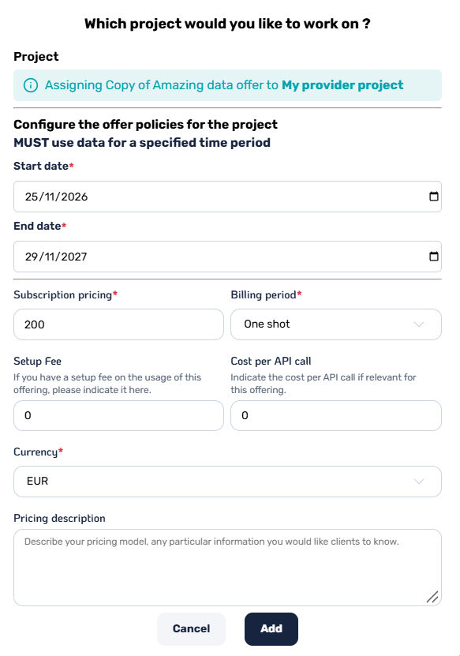

# Contributions

When you are orchestrator of a project and still wish to run data exchanges with offers you own. It is _mandatory_ to add these offers to the project, otherwise, the contract will not hold information regarding these offers and the connectors will not be able to use said offers in data sharing processes.

Adding an offer to your own project is called a **contribution**.

## Adding contributions

On your project page, open the **Contributions** page.

Then browse for the offer you want to add to the project

And finally configure the offer with the policies & pricing that apply to that project before adding it to the project.

Once added, the offer will become part of the Project and be included in the Project Contract agreement.

If you do not have the offer yet, click the **Create an offer** button of the page: see [Create an offer](../registering-resources/creating-an-offer.md).

## Modify a contribution

To change the policies and the pricing of one of your contributions, open the "Participants" page of the project, and click the **Modify** button next to your offer, in "Your contributions". The window "Update assignation" lets you change the usage policies of the offer for this project, for example the time period, and its pricing: the subscription pricing, the billing period, the setup fee, the cost per API call, the currency and the pricing description. Click the **Modify** button of the window to save your changes.