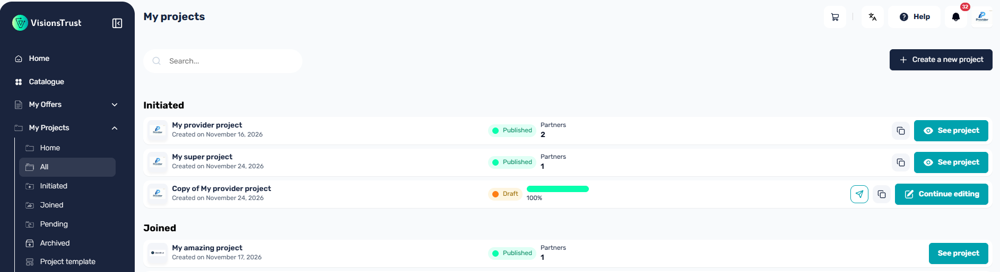
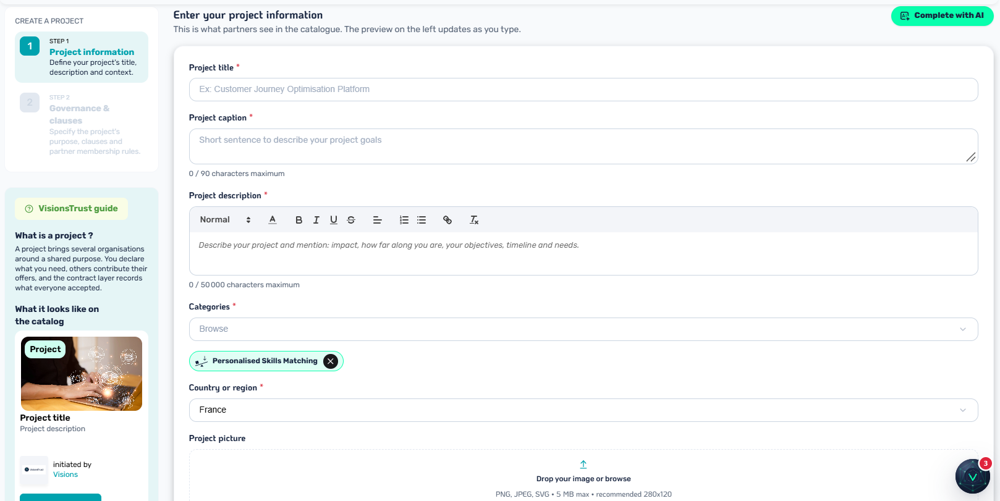
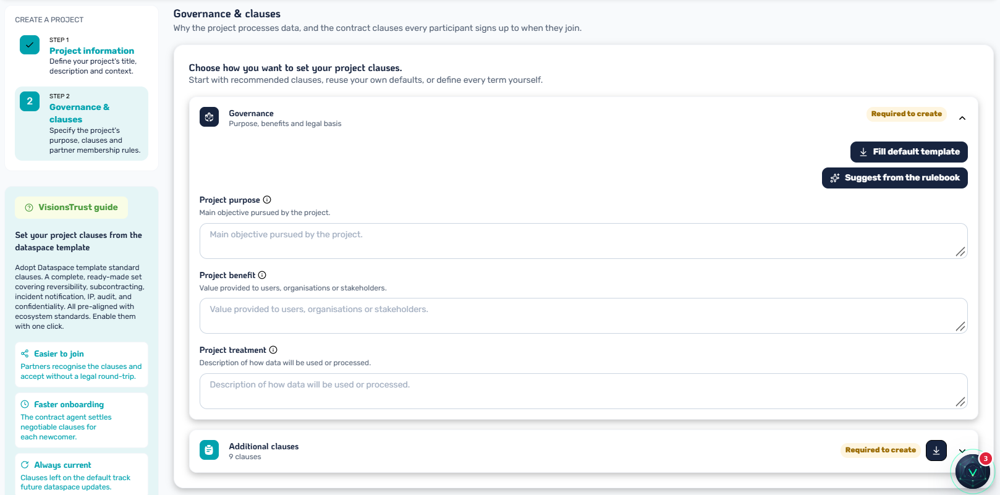
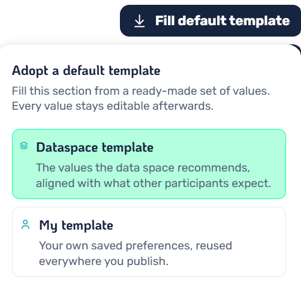

# Create a project

<!-- TODO: to redo after the new videos are recorded (the interface has changed)
https://drive.google.com/file/d/1cFo5cUDDg6LyVkxU-Dposkk8Ib9kRPNB/preview
-->

There are multiple ways to start creating a project, the easiest of which being by going to "My Projects" available in the navigation sidebar, which will take you to the page displaying all your existing projects and the "Create a new project" button to start creating a new one. You can also create a project from the basket, at [step 2](../basket/basket-steps.md#step-2-assign-to-project).

## Starting the creation of your project

On the My Projects page, there is a "Create a new project" button at the top right of the page to start creating your project. This will open the creation page, which guides you through 2 steps to register the essential information for your project. The guide on the left explains each step and shows a preview of your project as it appears in the catalogue.

## Step 1: General Information Registration

In the first step, you enter the basic information for your project, such as its title, caption for the catalogue, description, location and an optional image for display in the catalogue. You also choose the category of your project, which makes it easy to find in the catalogue when filtering by category and enables recommendations of offers and participants based on this category.

If you don't set an image for your project, your logo will be used instead.

Click the **Continue** button to go to the second step, or the **Create as draft** button to save the project and finish it later.

## Step 2: Governance and Clauses

The second step defines why the project processes data, and the contract clauses that every participant accepts when joining the project. Each field has an "i" icon: hover over it to read an explanation of what to enter. To complete it:

1. Fill in the "Governance" section: the project purpose, the project benefit and the project treatment.
2. Fill in the "Additional clauses" section. It has 9 clauses (reversibility / exit, subcontracting / third-party transfer, security incident notification, intellectual property on outputs, governing law & jurisdiction, force majeure, audit right, confidentiality and amendment / modification). For most of them, you choose a value in a drop-down list.
3. Click the **Continue** button to create the project.

## Using a template

You don't have to fill in every field yourself. Each section has a **Adopt dataspace template** button, which opens a window to fill the section from a ready-made set of values. Every value stays editable afterwards.

- **Dataspace template**: the values the data space recommends, aligned with what other participants expect.
- **My template**: your own saved preferences, which you set in "My Contracts", in the "Project template" tab.

## Required fields and drafts

The two sections are marked "Required to create". The **Continue** button creates the project as a draft, and its page opens. If you want to save your progress without completing the required fields, click the **Create as draft** button instead. The project page shows its completion percentage, and the sections still incomplete are highlighted.

Once all the information has been set, you can create your project and move on to [managing your project](./project-settings.md).