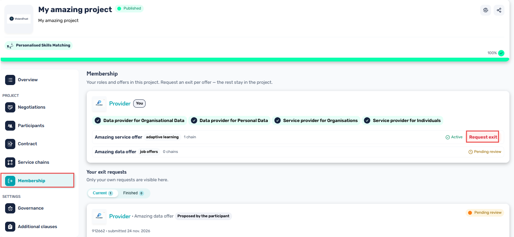
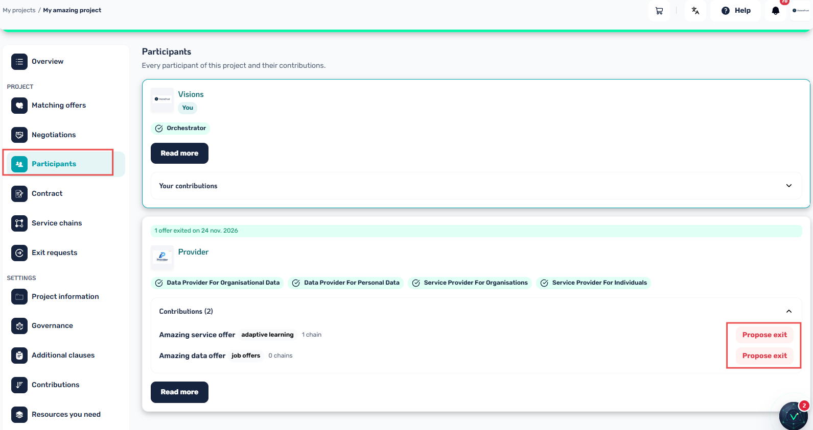
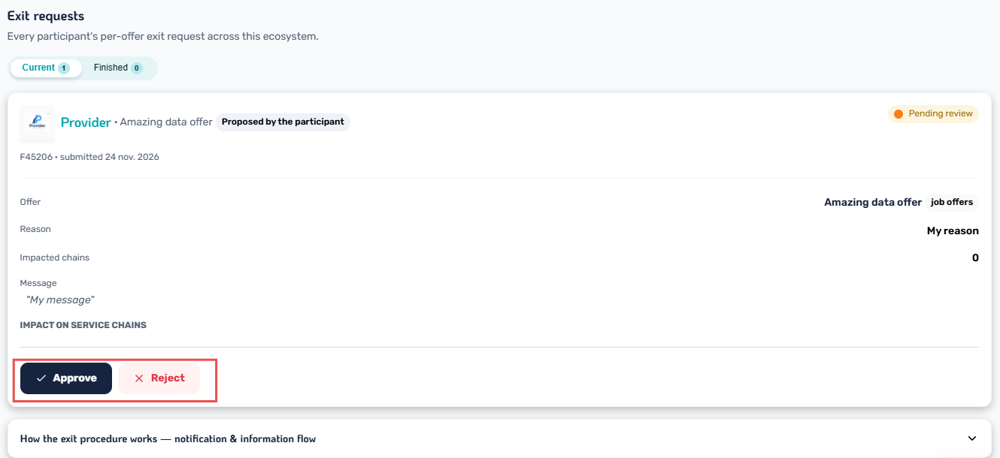

# Exit requests

A participant stays in a project, but can withdraw one of its offers. This is called an exit request. An exit is made offer by offer: the other offers of the participant stay in the project.

Either side can start an exit:

- The participant requests the exit of one of its offers.
- The orchestrator proposes the exit of an offer of a participant.

The other side then approves or rejects it.

## Request the exit of an offer

If you are a participant, use the "Membership" page of the project to request the exit of one of your offers and to follow your requests.

1. Open the project and click "Membership" in the menu.
2. Click the **Request exit** button next to the offer you want to withdraw.
3. In the window, fill in the **Reason** and the **Message**. The orchestrator sees both.
4. Check the "Impact on service chains" list. It shows each service chain and what happens to it: "Will go back to draft" if the chain uses the offer, "Not affected" if it does not.
5. Click the **Request exit** button. The message "Your exit request has been submitted" appears, and the offer shows "Pending review".

## Propose the exit of an offer

If you are the orchestrator, use the "Participants" page of the project to propose the exit of an offer of a participant.

1. Open the project and click "Participants" in the menu.
2. Find the participant and click the **Propose exit** button next to the offer.
3. Fill in the **Reason** and the **Message**, check the impact on service chains, then click the **Request exit** button. The offer now shows "Exit requested".

The participant then approves or rejects your proposal from the "Membership" page.

## Approve or reject a request

You receive a notification that tells you who requested the exit, which offer and which project. It asks for your response.

- **Orchestrator**: open "Exit requests" in the menu of the project. The "Current" tab lists the requests waiting for your answer ("Pending review"). Each card shows the offer, the reason, the message and the impact on each service chain.
- **Participant**: for a proposal of the orchestrator, open "Membership". The proposal is in "Your exit requests".

Click the **Approve** button to accept the exit, or the **Reject** button to refuse it with a reason. The other side sees your reason as "Reason for rejection", apart from the original message.

## After an approval

The exit is effective immediately:

- The offer leaves the project and its contract. It no longer appears in the contract.
- The service chains that used the offer go back to draft, without the offer. They show "Impacted by an exit request": edit them before activating them again.
- The participant stays in the project, even if it has no offer left. The offers that left can be added back through a renegotiation, not through the basket: see [Restart a negotiation](../negotiation/restarting-a-negotiation.md).

If the exit is rejected, nothing changes: the offer stays in the project.

## Follow your requests

The "Exit requests" page (orchestrator) and the "Membership" page (participant) have two tabs: "Current" and "Finished". A finished request shows its result: "Exited" with the date, or "Rejected".

## Bring an offer back

An offer that has exited can come back through a renegotiation: see [Restart a negotiation](../negotiation/restarting-a-negotiation.md). The offer is listed again in "Add other offers of the participant".
