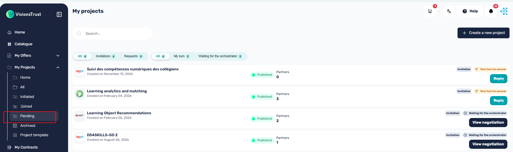

# My Projects

> Find the definition of a project in the [glossary](../../glossary.md).

## Find your projects

Click "My Projects" in the sidebar navigation menu. Its submenu has these entries:

- "Home": a summary of your projects and a guide
- "All", "Initiated" and "Joined": your projects, with the ones you launched and the ones you joined
- "Pending": the invitations and the join requests that wait for an answer, see [Pending invitations and requests](#pending-invitations-and-requests)
- "Archived": your archived projects, see [Archive a project](./project-settings.md#archive-a-project)
- "Project template": your project template, see [Project template](./project-template.md)

### Home of "My Projects"

The **Create a new project** button at the top starts the creation of a project: see [Create a project](./creating-a-project.md).

The "Home" page summarises your projects with three figures: **Number of projects launched**, **Total access requests** and **Contract status of projects** (the signed contracts and the contracts pending validation).

A guide in three parts follows, with the actions to take for each one:

- "Launch and structure your data and AI project": create and describe your project, define your contribution and the technical components, then publish it.
- "Find the most relevant offers for your project": explore the matchings of your project, search the catalogue, and add the offers to your basket.
- "Negotiate and contract with confidence": invite the providers, then negotiate the terms with them: see [Project Negotiation](../negotiation/project-negotiation.md).

### Pending invitations and requests

The "Pending" page lists the invitations you received and the join requests you sent, as long as they are not concluded.

Each card has a tag:

- "Invitation": an orchestrator invited your offers to its project.
- "Request": you asked to join the project.

Each card also tells who has to act:

- "Your turn to answer": the orchestrator is waiting for you. Click the **Reply** button to review the proposal: see [Review a negotiation](../negotiation/negotiation.md).
- "Waiting for the orchestrator": the next step is on the side of the orchestrator. You have nothing to do.

To find a card faster, use the tabs: "Invitations" and "Requests" filter by tag, "My turn" and "Waiting for the orchestrator" filter by who has to act.
