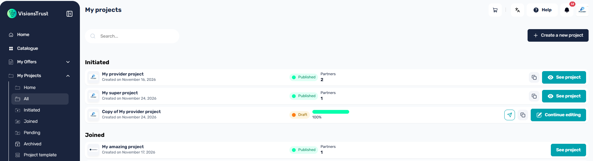
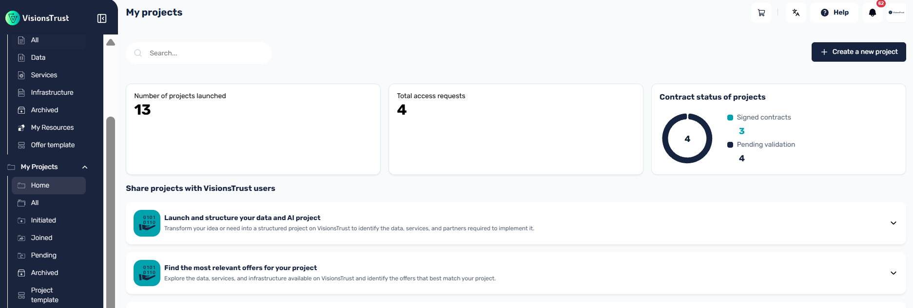

# Projects

> Find the definition of a project in the [glossary](../../glossary.md).

## For Orchestrators
If you have a project in mind to connect data sources to services for defined purposes, projects are the way to go.

Projects enable you to setup a space for enabling your use cases. You will be able to define which participants should be members of the use case, what the project needs to get some recommendations and setup a project contract to regulate the data exchanges that operate under the context of this project.

You can get started with a new project by reading on [how to create a project](./creating-a-project.md).

## For Providers
As a provider of data or services, you might be interested in joining projects that could fit the usage of your services and provide you with interesting value.

### Recommendations
After registering resources and offers as a Provider in the catalogue, project recommendations will start appearing on your [Home Page](../dashboard.md) on which you will be able to easily discover details about these projects and make join requests to them if they are indeed interesting for you.

## Find your projects

Click "My Projects" in the sidebar navigation menu. Its submenu has these entries:

- "Home": a summary of your projects and a guide
- "All", "Initiated" and "Joined": your projects, with the ones you launched and the ones you joined
- "Archived": your archived projects, see [Project page](./project-settings.md)
- "Project template": your project template, see [Templates](../templates/overview.md)

### Home of "My Projects"

The **Create a new project** button at the top starts the creation of a project: see [Create a project](./creating-a-project.md).

The "Home" page summarises your projects with three figures: **Number of projects launched**, **Total access requests** and **Contract status of projects** (the signed contracts and the contracts pending validation).

A guide in three parts follows, with the actions to take for each one:

- "Launch and structure your data and AI project": create and describe your project, define your contribution and the technical components, then publish it.
- "Find the most relevant offers for your project": explore the matchings of your project, search the catalogue, and add the offers to your basket.
- "Negotiate and contract with confidence": invite the providers, then negotiate the terms with them: see [Project Negotiation](../negotiation/project-negotiation.md).
