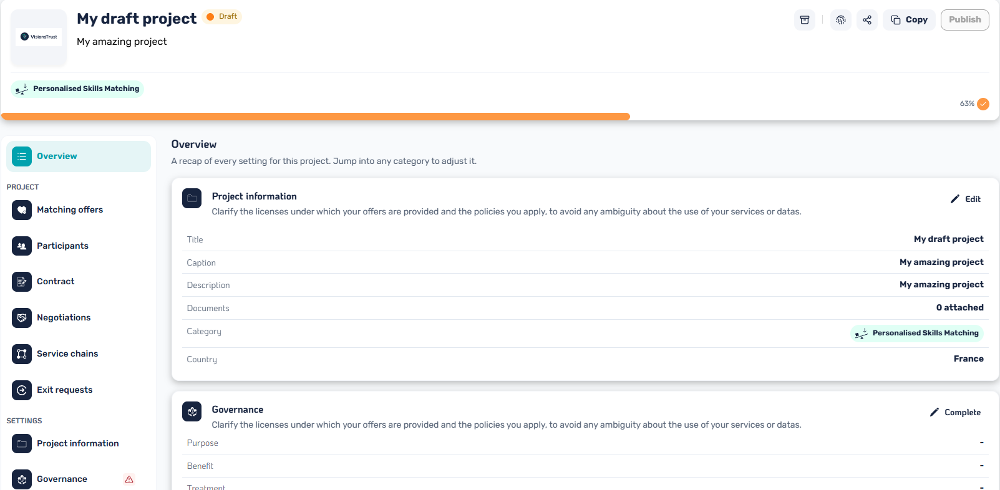
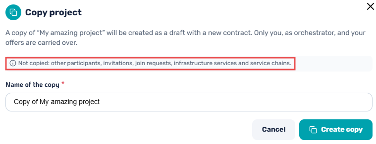

# Project page

After successfully creating a project, it can be managed and configured in more detail than just the initial required elements. To open it, go to "My projects" and click your project.

At the top of the project page, you find the status of the project (Draft or Published) and its completion percentage. The buttons next to it let you:

- **Archive** (box icon): archive the project. A project can only be archived if it contains no offer other than the orchestrator's own offers
- **Copy project id** (fingerprint icon): copy the identifier of the project
- **Share link** (share icon): share the project with a link
- **Copy**: create a copy of the project as a draft, see [Copy a project](#copy-a-project)
- **Publish**: publish the project. Once the project is published, this button becomes **Unpublish**.

## Completing your project

The **Overview** of the project gives a recap of every setting and shows what is left to complete: a section that is still incomplete shows a **Complete** button.

**Governance** and **Additional clauses** are required to publish your project and count in its completion percentage: a warning triangle in the menu shows when one of them is incomplete, and each field has an "i" icon that explains what to enter.

The other settings are optional and can be completed at any time:

- Defining Tech requirements: Tech components that your project will use for regulating data exchanges in the project. Some are mandatory and will be set for you by default.
- Contributions: Contributions that you can add to the project, as in data or services that you would like to the contribute to the project for them to be used by the other participants in the project. See [Contributions](./contributions.md).
- Resources you need: the categories of data and services your project looks for, which improves the recommendations in "Matching offers".

!!! info "Projects created before November 26, 2026"
    Governance and Additional clauses did not exist when these projects were created. Their values have been filled in with the dataspace default values, and you can modify them at any time. You received a notification and an email about this change.

## Understanding project publication

Configuring your project fully allows you to publish it and make it available to the catalogue. While in draft, even though you will be able to receive recommendations for offers, you will not be able to invite them to your project nor will them be able to find your project in the catalogue or in their recommendations.

A draft project:

- Is not available to the catalogue
- Is not recommended to other participants
<!-- - Cannot invite offers or participants to join it à vérifier -->

A published project:

- Is available on the catalogue
- Can be searched in the catalogue
- Is recommended to participants that have matching offers
- Can invite offers / participants to join it
- Can receive join requests from participants that want to join

Once your project is published, participants can join it, either because you [invited their offers](../negotiation/invitations.md) or because they [sent a join request](../negotiation/join-requests.md). They are then listed in the "Participants" page of the project, with their role and their contributions. To follow the negotiations of your project, open the ["Negotiations" page](../negotiation/following-negotiations.md). A participant can also withdraw one of its offers: see [Exit requests](./exit-requests.md).

## Project Subscription

VisionsTrust operates under a pricing model in which you manage a paid subscription per project. This section will not go too much in these details as when you attempt to publish a project, the platform will guide you through understanding how to activate a subscription in order to make your project published.

## Project Contract

Upon creating a project, whether it is in a draft or published state, a contract for the project is generated in an unsigned state. The Contract page displays the terms of the project, its participants and their contributions.

To invite participants and ensure data exchanges are authorized, all participants, including you as the orchestrator, should validate this contract with the **Validate** button on this page. The contract can only be signed once the project is published. See [Contracts](../my-contracts/signing-a-contract.md).

## Copy a project

Click the **Copy** button to create a draft copy of your project. A window opens:

1. Change the name of the copy if you want. By default, it is "Copy of" followed by the name of the project.
2. Click the **Create copy** button.

The copy is created as a draft with a new contract. Only you, as orchestrator, and your offers are carried over. The other participants, the invitations, the join requests, the infrastructure services and the service chains are not copied: you can invite the participants again, and create the chains again.

## Archive a project

Click the **Archive** button of the project, then **Confirm** to archive it. Its status becomes "Archived".

A project can only be archived if it contains no offer other than the orchestrator's own offers.

Archived projects are listed in the "Archived" tab of "My Projects". Each card shows the name of the project, its creation date, its status "Archived" and a **See project** button.

## Participants

The "Participants" page lists every participant of the project, with its roles and its contributions. Your own card is marked "You": its "Your contributions" block lists your offers, each with a **Modify** button (see [Contributions](./contributions.md)). The card of another participant lists its offers, with the number of service chains that use each one. Click the **Read more** button to open the page of the organisation in the catalogue, or **Propose exit** to propose the exit of one of its offers (see [Exit requests](./exit-requests.md)). When offers have left the project, the page tells you how many. The **Resend notification to sign** button sends the participant a new notification to sign the contract. It is displayed only while the participant has at least one offer in the project and has not signed yet.