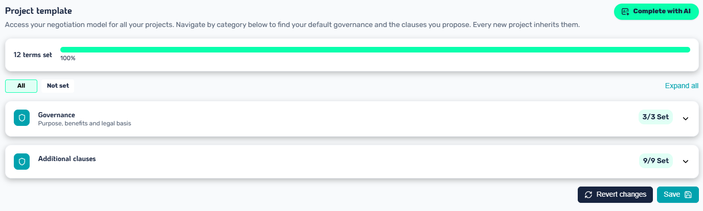

# Project template

Your project template is your own set of default values for the terms of a project. You set it once, and every new project inherits these values.

It contains the same sections as the second step of the project creation: the governance of the project and its 9 additional clauses.

## Set up your template

1. Open "Project template" in the "My Projects" menu.
2. Fill in the terms, or use the **Adopt dataspace template** button of a section to start from a ready-made set of values.
3. Click the **Save** button at the bottom of the page.

The counter shows how many terms are set, and the completion percentage of the template.

## Use your template

When you create a project, click the **Adopt dataspace template** button and choose "My template" to apply these values: see [Create a project](./creating-a-project.md).
