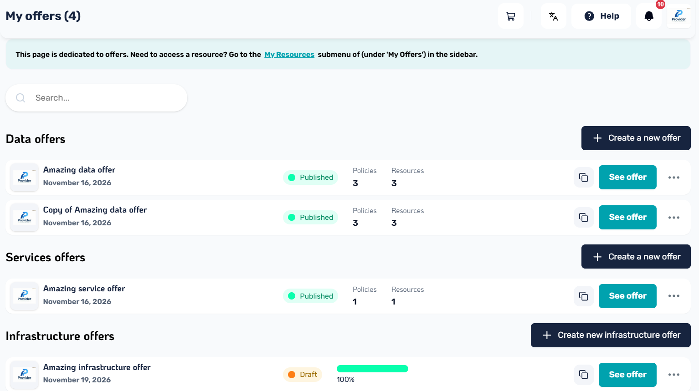
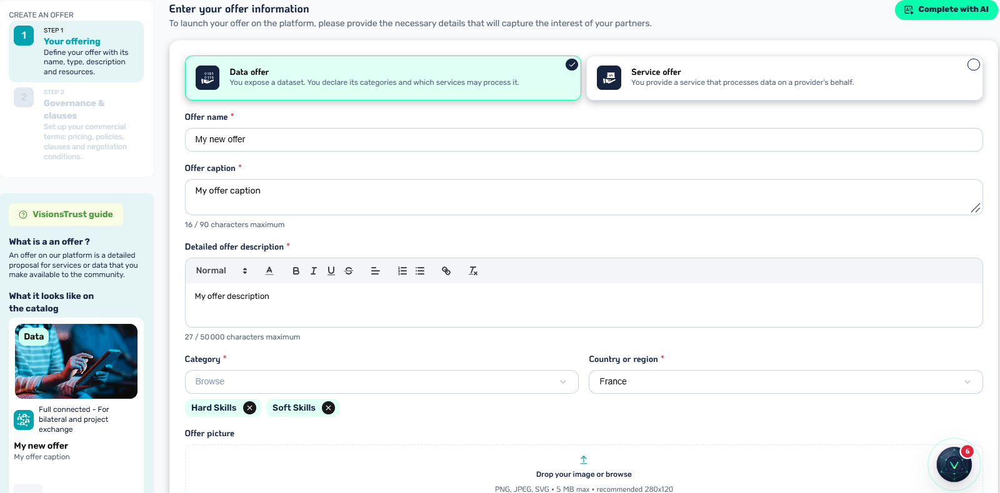
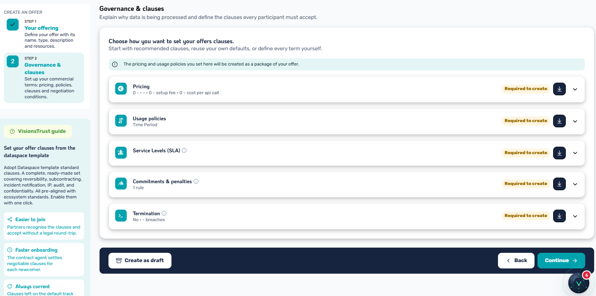

# Create an offer
<!-- <iframe src="https://drive.google.com/file/d/15AzzOkpF6tv3dsuMH9zNDt8VYyXgDFkn/preview" width="640" height="380" allow="autoplay"></iframe>  to be replaced when new video is available -->

## Creating the draft offer

You can access the environment to create an offer in multiple places. The easiest is to click "My Offers" in the sidebar navigation menu, which takes you to the list of all your existing, draft and published offers.

Click the **Create a new offer** button to open the creation page. It guides you through 2 steps to define your offer: "Your offering", then "Governance and clauses". The guide on the left explains each step.

### Step 1: Your offering

Choose the type of your offer: a data offer if you expose a dataset, or a service offer if you provide a service that processes data. Then enter its general information.

The mandatory fields are the type, the name, the caption, the description, the category and the country or region. The picture is optional. Each field is described in the [Offer page](./offer-settings.md#offer-information).

Click the **Continue** button to go to the second step once the mandatory fields are filled in. To finish later, click the **Create as draft** button, in either step: the offer name and its caption are enough to save a draft.

### Step 2: Governance and clauses

The second step defines your commercial terms and the clauses that every participant accepts. It has five sections, all marked "Required to create": pricing, usage policies, service levels (SLA), commitments & penalties, and termination. The pricing and the usage policies you set here are created as a package of your offer.

In the pricing section, the "Price is negotiable" toggle lets you decide if the price can be negotiated. When it is switched on, orchestrators can propose their own price for your offer during the negotiation. Otherwise, the price is fixed.

#### Usage policies

In the usage policies section, you choose the policies that apply to your offer: "Time period" (the data must be used for a specified time period) and "Count" (the data must not be used more than a given number of times). If you do not select any policy, your offer has no restriction on the period or the number of times it can be used. In the catalogue, the package concerned then displays "No time or count restrictions".

Each term of a policy has an **Auto-accept** toggle. When you switch it on, you set the range of values you accept for this term, and the proposals you receive during a negotiation are compared with this range. For now, nothing is accepted automatically: you still have to respond to each negotiation.

!!! info "Coming soon"

    Proposals that fall within your range will be accepted automatically.

#### Filling the sections with a template

You don't have to fill in every field yourself. Each section has a **Fill default template** button, which opens a window to fill the section from a ready-made set of values. Every value stays editable afterwards.

- **Dataspace template**: the values the data space recommends, aligned with what other participants expect.
- **My template**: your own saved preferences, which you set in your offer template (see [Templates](../templates/overview.md#offer-template)).

Pricing and usage policies are not available in the Dataspace template.

Click the **Continue** button to create the offer. In all cases, the offer is created as a draft.

## Fine-tuning the settings of the offer

Now that your offer is created, you can complete it on its own page: add resources, define your pricing packages, and set the service levels, the commitments & penalties and the termination conditions. All of this is described in the [Offer page](./offer-settings.md). Once the mandatory information is complete, you can publish your offer: see [Publishing the offer](./offer-settings.md#publishing-the-offer).
