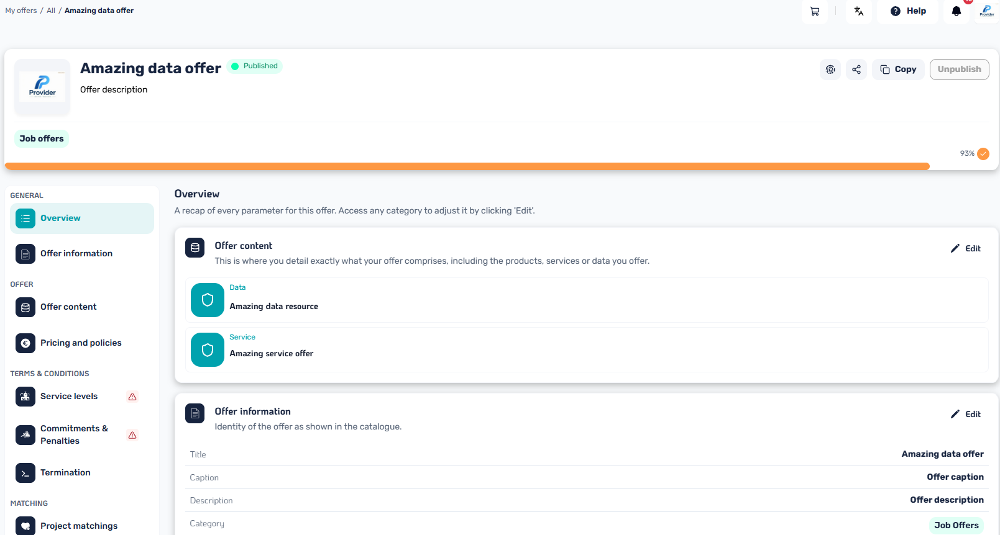
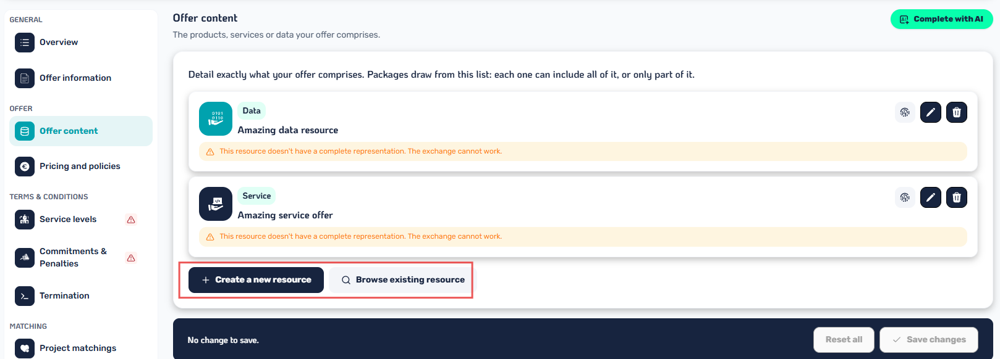
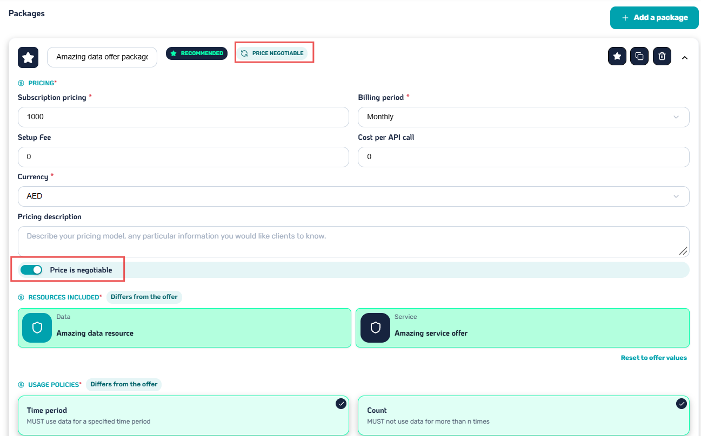
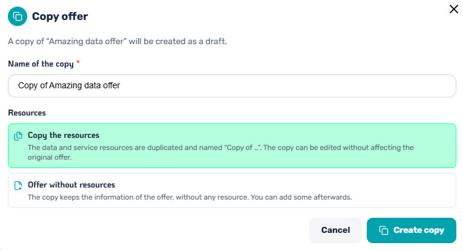
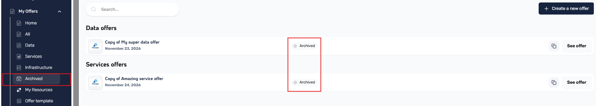

# Offer page

After you create an offer, its own page lets you complete it, publish it and follow how it performs. To open it, click "My Offers" in the sidebar navigation menu, then click your offer.

## Offer status and actions

At the top of the page, you find the status of the offer (Draft or Published) and its completion percentage. The buttons next to it let you:

- **Archive** (box icon): archive the offer, see [Copy, archive and restore an offer](#copy-archive-and-restore-an-offer)
- **Copy offer id** (fingerprint icon): copy the identifier of the offer
- **Share link** (share icon): share the offer with a link
- **Copy offer**: create a copy of the offer as a draft, see [Copy, archive and restore an offer](#copy-archive-and-restore-an-offer)
- **Publish**: publish the offer. Once the offer is published, this button becomes **Unpublish**.

## Completing your offer

The menu on the left lists the sections of the page. The "Overview" gives a recap of every section, with an **Edit** button to open each one. In each section, **Save changes** saves your modifications and **Reset all** cancels them.

To publish an offer, these sections must be complete. Click a section to see its details below:

- ["Offer information"](#offer-information)
- ["Offer content"](#offer-content)
- ["Pricing and policies"](#pricing-and-policies)
- ["Service levels"](#service-levels-sla)
- ["Commitments & Penalties"](#commitments-penalties)
- ["Termination"](#termination)

A warning triangle in the menu marks a section that is still incomplete.

The "Pricing and policies" section and the three sections of "Terms & Conditions" each have an **Adopt dataspace template** button, which fills it from the Dataspace template or from your offer template (see [Templates](../templates/overview.md#offer-template)).

!!! info "Offers created before November 26, 2026"

    The new fields did not exist when these offers were created. Their values have been filled in with the dataspace default values, and you can modify them at any time. A banner "Terms completed with the data space defaults" on the page of the offer reminds you to review them. You received a notification and an email about this change.

## Publishing the offer

Once the mandatory information of your offer is complete, you can publish it. The publication status defines how your offer appears in the catalogue and whether it is recommended to other participants.

**A draft offer:**

- Is not available in the catalogue
- Is not recommended to other participants

**A published offer:**

- Is available in the catalogue
- Can be searched in the catalogue
- Is recommended to projects that search the category of offers matching yours

Click the **Publish** button to publish your offer. Once published, click the **Unpublish** button to take it back to draft, or the **Archive** button to archive it.

## Offer information

The information entered in the first step of the creation. You can modify all of it here, except the type of the offer, which is chosen when you create it.

| Field | Mandatory | What it is |
| --- | --- | --- |
| Offer name | yes | The name of your offer |
| Offer caption | yes | A short caption (90 characters maximum) describing your offer, so that it is quickly understood when displayed in the catalogue |
| Detailed offer description | yes | A longer description (50 000 characters maximum), with rich text support, to fully define your offer |
| Category | yes | The categories your offer fits into. This is essential for matching it with projects and providing recommendations |
| Country or region | yes | The location in which your offer operates or is stored |
| Offer picture | no | If set, it is displayed in the catalogue. Otherwise, your organization logo is displayed (PNG, JPEG or SVG, 5 MB maximum, recommended size 280x120) |

## Offer content

The offer content is the list of data and/or service resources that your offer comprises. An offer **needs** at least one resource to be published.

When you create a data offer, a data resource with the same name is created automatically and added to your offer, so that the offer already has one resource. You can complete it in the "My Resources" page, for example with the anonymised extract and the update frequency.

To add other resources:

1. Open "Offer content" in the menu on the left.
2. Click the **Create a new resource** button to create a resource, or the **Browse existing resource** button to add one you already have.
3. Click the **Save changes** button.

The creation of a resource is described in [Create a data resource](./data-resources.md) and [Create a service resource](./service-resources.md). The packages of your offer draw from this list: each package can include all the resources, or only some of them.

## Pricing and policies

The pricing of an offer is managed through packages. You can define from one to three packages, which let orchestrators choose the formula that suits them. Each package can have its own price, its own resources and its own usage policies.

Click the **Add a package** button to add a package. The packages are shown to the orchestrators in the order you set.

A package shows a "PRICE FIXED" or "PRICE NEGOTIABLE" tag. Orchestrators see this tag in the catalogue and in their basket, so they know whether they can negotiate the price.

Each package has a name that you can edit, and three buttons next to it:

- **Recommended** (star icon): mark the package as recommended. It then shows the "RECOMMENDED" badge to orchestrators
- **Duplicate package** (copy icon): create a copy of the package
- **Remove package** (bin icon): remove the package

For each package, you can edit:

| Field | Mandatory | What it is |
| --- | --- | --- |
| Subscription pricing | yes | The price of the package |
| Billing period | yes | How often the price is paid: one shot, daily, weekly, monthly, every 3 months, every 6 months or annually |
| Setup fee | no | A one-time fee to start using the package, if any |
| Cost per API call | no | The price of each call to your service, if any |
| Currency | yes | The currency of the price |
| Pricing description | no | Free text for any additional pricing information that users should know |
| Price is negotiable | no | When it is switched on, the orchestrators can propose their own price during the negotiation. Otherwise, the price is fixed |
| Resources included | yes | The resources of the offer that the package includes. Click **Reset to offer values** to include all of them again |
| Usage policies | yes | The policies that apply to the package: "Time period" and "Count". By default, a package uses the policies of the offer |

The usage policies are described in [Create an offer](./creating-an-offer.md#usage-policies), including the **Auto-accept** toggle.

## Terms & conditions

### Service levels (SLA)

The service levels are what you guarantee as a provider: how often your offer is available, how fast it responds, how often the data is updated and how to reach your support. Hover over the "i" icon next to a field to read its explanation.

| Field | Mandatory | What it is |
| --- | --- | --- |
| Delivery deadline | yes | The maximum delay between the signature of the contract and the first moment the resource is available for the consumer |
| Availability / uptime | yes | The percentage of time the resource is guaranteed to be up and reachable. For example, 99.9% allows about 43 minutes of downtime per month |
| Update frequency | yes | How often the data is refreshed or the service updated, from real-time streaming to a static resource that is never updated |
| Response time | yes | The maximum response time of your service or API, and how it is measured (average, 95th or 99th percentile) |
| Availability time window | yes | The hours during which the resource is guaranteed to be available: 24/7, business hours (5 days × 8 hours) or extended hours (5 days × 12 hours) |
| Retention period | yes | How long the data is kept after the end of the contract before it is deleted |
| Availability period | yes | How long the data stays accessible to the consumer once delivered: for the session only, a fixed duration, the whole contract or until consent is withdrawn |
| End of support date | yes | The date from which support (assistance, fixes, updates) ends, even if the resource remains accessible |
| End of life date | yes | The date from which the resource is decommissioned and is no longer accessible |
| Support channels | yes | The channels through which the consumer can reach your support. You can select several |
| Support service hours | yes | The hours during which your support team handles requests |
| Support severity level | yes | The target response time of your support for each severity, from critical (service down) to low (minor issue or question) |
| Measurement / monitoring method | no | How the indicators above are measured or monitored: tool used, frequency, reporting |
| SLA note | no | A free note for special cases or details not covered by the fields above |

### Commitments & penalties

A commitment ties a service level to a threshold, for example availability below 99% over a month. When the threshold is crossed, the consequence of the rule applies. Each rule is numbered (Commitment 1, and so on).

| Field | Mandatory | What it is |
| --- | --- | --- |
| Commitment concerned | yes | The service level covered by the rule: availability / uptime, response time, delivery deadline or support service hours |
| Trigger threshold | yes | The condition under which the commitment is considered not met: an operator and a value (for example availability below 99.5%), a value outside the agreed window, or a deliverable not delivered |
| Type of consequence | yes | What happens when the commitment is not met: service credit, discount, refund, fee waiver, suspension, termination, fixed compensation, or a cure period followed by escalation |
| Penalty amount | yes | The amount or percentage applied, and its basis (period fee, total value, fixed amount, credit days or per incident). The available bases depend on the type of consequence |
| Penalty / liability cap | yes | The maximum total of the penalties and the overall liability ceiling: a percentage of the monthly fee, of the annual fee or of the total contract value, a fixed cap, or no cap |
| Measurement period | yes | The period over which a breach is assessed: per incident, per calendar period (day, week, month or quarter), over a rolling 30 or 90-day window, or over the whole contract |
| Claim procedure & deadline | yes | How the penalty is obtained (automatic credit, formal claim or support ticket) and the deadline, in days after the breach, to claim it |
| Penalty note | no | A free note for special cases |

### Termination

The termination conditions define how either party can end the contract before its term: at any time with notice (for convenience), or after repeated breaches (for cause).

| Field | Mandatory | What it is |
| --- | --- | --- |
| Termination for convenience | yes | The right for a party to end the contract before its end date, without having to give a cause (yes or no) |
| Notice period for early termination (days) | yes | The number of days in advance the other party must be informed |
| Threshold for automatic termination | yes | The number of SLA breaches or penalty events needed before a termination for cause is triggered |
| Notice period for termination for cause | yes | Immediate termination (no notice) or a notice period of a set number of days |
| Notice period for termination for cause (days) | yes | The number of days of notice before a termination for cause takes effect |
| Termination on regulatory / security incident | yes | Whether the contract ends automatically if a regulatory finding or a security breach is confirmed: immediately, after a notice period, or assessed case by case |
| Regulatory / security notice period (days) | yes | The number of days of notice before the contract ends after a confirmed finding or breach |
| Cumulative penalty cap termination | yes | Whether reaching the cumulative penalty cap defined in the commitments lets the contract be terminated |
| Suspension as intermediate step | yes | Whether access is first suspended, giving you time to fix the breaches, before the contract is terminated |
| Suspension duration (days) | yes | The number of days the suspension lasts before the termination takes effect, if the breaches are not remedied |

## Matching projects

This page lists the projects of the catalogue that match your offer, based on its category. If there is none, the message "We don't have any recommendations to propose to you." is displayed.

## Indicators

### Business indicators

The business indicators give you the key business metrics of your offer: the total of projects using it, the total revenue generated, the total of access requests (you can choose the period, "All time" by default), and the status of its contracts (signed and pending validation).

### Technical indicators

The technical indicators give you the key technical metrics of your offer: the exchanges (successful, total and success rate for each offer) and a table of the errors, with their date, status, offer, ecosystem, participant, error and location.

## Copy, archive and restore an offer

### Copy an offer

Click the **Copy offer** button to create a draft copy of your offer. A window opens:

1. Change the name of the copy if you want. By default, it is "Copy of" followed by the name of the offer.
2. Choose what to copy: **Copy the resources** duplicates the data and service resources and names them "Copy of ...", so that the copy can be edited without affecting the original offer. **Offer without resources** keeps the information of the offer without any resource: you can add some afterwards.
3. Click the **Create copy** button. The message "Offer copied" appears, and the page of the copy opens.

### Archive an offer

Click the **Archive** button, then **Confirm** to archive the offer. Its status becomes "Archived" and the **Publish** button is replaced by **Unarchive**.

An offer can only be archived if it is not part of a project. If it is, the **Archive** button is not displayed: the offer must first leave the project (see [Exit requests](../projects/exit-requests.md)).

### Find and restore an archived offer

Archived offers are listed in the "Archived" tab of "My Offers". Each card shows the status "Archived" and a **See offer** button. On the page of the offer, click **Unarchive** to restore it: the offer comes back as a draft, and you can publish it again.
