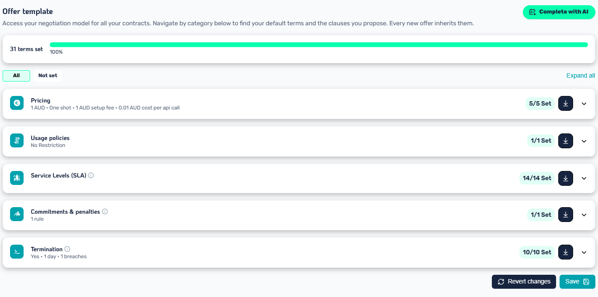

# Offer template

Your offer template is your own set of default values for the terms of an offer. You set it once, and every new offer inherits these values.

It contains the sections of an offer: pricing, usage policies (count and time period), service levels (SLA), commitments & penalties, and termination.

## Set up your template

1. Open "Offer template" in the "My Offers" menu.
2. Fill in the terms, or use the **Adopt dataspace template** button of a section to start from a ready-made set of values.
3. Click the **Save** button at the bottom of the page.

The counter shows how many terms are set, and the completion percentage of the template.

## Use your template

When you create an offer, click the **Adopt dataspace template** button and choose "My template" to apply these values: see [Create an offer](./creating-an-offer.md).
