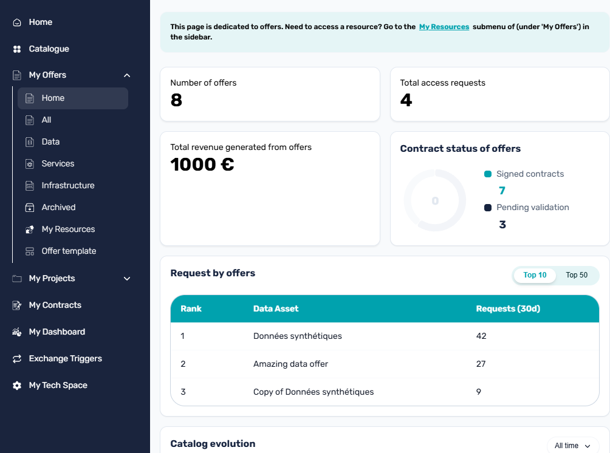

# My Offers

Offers are made available by providers who register data or services on the catalogue.
## What is an offer?

An offer is a set of [data](./data-resources.md) and/or [service](./service-resources.md) resources provided by a participant of the data space, bundled together to form a business & technical product that can be discovered on the catalogue and used by other participants and projects (after negotiating its usage).

### Offer and resource

A resource is the metadata that defines a single unit of data or a single service, used in an offer. An offer can contain several data and service resources. Only offers are visible in the catalogue.

To learn more, see how to create [data](./data-resources.md) resources or [service](./service-resources.md) resources.

### What an offer is composed of

An offer is composed of:

- **General information**: name, caption, description, category... See [Offer page](./offer-settings.md#offer-information).
- **Resources**: the data and/or services the offer comprises. See [Offer page](./offer-settings.md#offer-content).
- **Packages**: the pricing and the usage policies of your offer are grouped in packages. When you create an offer, they are used to create a first package, which includes the resource of the offer. You can add other packages later. See [Offer page](./offer-settings.md#pricing-and-policies).
- **Service levels, commitments & penalties, and termination**: what you guarantee, and what happens if you do not. See [Offer page](./offer-settings.md#service-levels-sla).

!!! note

    For technical profiles, the schema for Offers are based on Gaia-X defined [Service Offerings](https://docs.gaia-x.eu/policy-rules-committee/trust-framework/22.10/service/) and extended to fit the needs of {{ app_name }}.

!!! info

    For more information about policies and what it actually means in the system, please visit the [Prometheus-X Dataspace Connector documentation](https://github.com/Prometheus-X-association/dataspace-connector)

## Find your offers

Click "My Offers" in the sidebar navigation menu. Its submenu has these entries:

- "Home": a summary of your offers
- "All", "Data", "Services" and "Infrastructure": your offers, by type
- "Archived": your archived offers, see [Copy, archive and restore an offer](./offer-settings.md#copy-archive-and-restore-an-offer)
- "My Resources": your data and service resources, see [Data Resources](./data-resources.md)
- "Offer template": your offer template, see [Templates](../templates/overview.md#offer-template)

### Home of "My Offers"

The "Home" page summarises your offers:

- **Number of offers**, **Total access requests** and **Total revenue generated from offers**
- **Contract status of offers**: the number of signed contracts and of contracts pending validation
- **Request by offers**: a ranking of your data assets by number of requests over the last 30 days. Switch between **Top 10** and **Top 50**
- **Catalog evolution**: the number of new assets added each month, with a list to choose the period

The screenshot shows sample data. The figures about requests only appear if you have a connector and if exchanges have taken place on your offers. For more figures, see [My Dashboard](../my-dashboard.md).
