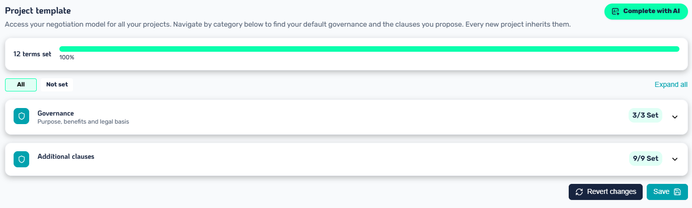
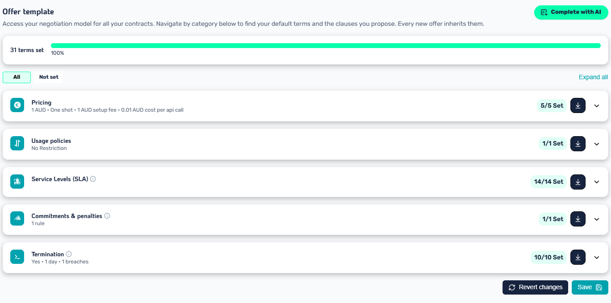

# Templates

A template is your own set of default values for the terms you propose. You set it once, and it is reused every time you create an offer or a project.

To set up a template:

1. Go to "My Contracts".
2. Under "My template", choose "Offer template" or "Project template".
3. Fill in the terms, or use the **Fill default template** button of a section to start from a ready-made set of values.
4. Click the **Save** button at the bottom of the page.

On both pages, the counter shows how many terms are set and the completion percentage of the template.

## Project template

Every new project inherits the values of your project template. It contains the same sections as the second step of the [project creation](../projects/creating-a-project.md#governance-and-clauses): the governance of the project and its 9 additional clauses. When you create a project, click the **Fill default template** button and choose "My template" to apply these values. See [Using a template](../projects/creating-a-project.md#using-a-template).

## Offer template

Every new offer inherits the values of your offer template. It contains the sections of an offer: pricing, usage policies (count and time period), service levels (SLA), commitments & penalties, and termination.

