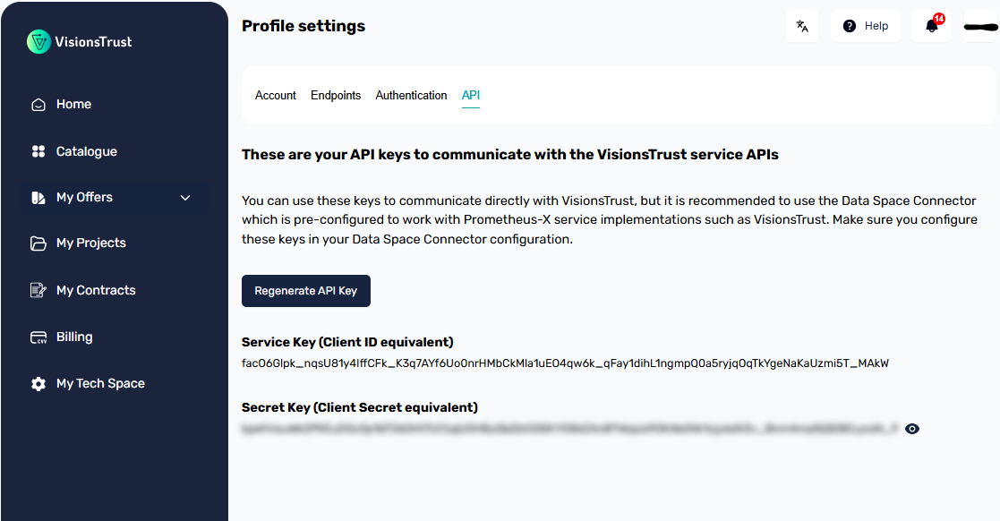

# API Keys

!!! info

    If you're unsure how to access this page, see [how to access your settings](./settings-access.md).

To communicate with {{ app_name }} via API or *to allow your PDC to interact with {{ app_name }} services*, you will need to grab the API Keys from your settings.

These API Keys are generated when your account is created and can be regenerated at any time.

For configuration in your PDC, you will need to provide these API Keys in the configuration file to ensure your PDC is capable of interacting with {{ app_name }} services and authorize data exchanges.

!!! warning

    Keep in mind that if you regenerate your API Keys, you will **need** to update your PDC configuration and reload it to ensure the new API Keys are correctly propagated. Failure to do this will result in all your data exchanges being blocked.

## Your keys

The "API" page of your settings shows three keys:

- **Service Key (Client ID equivalent)**
- **Secret Key (Client Secret equivalent)**
- **Exchange trigger Key (PDC Key)**: the API key of your connector, which authorizes VisionsTrust to request exchanges from the exchange trigger page

Click **Copy** to copy a key. The secret key and the exchange trigger key are hidden: click **Display** to show them.

## Regenerate your keys

- Click **Regenerate service & secret API Keys** to create a new service key and a new secret key.
- Click **Regenerate exchange trigger API Key** to create a new exchange trigger key.

!!! warning "The previous key stops working"

    When you regenerate a key, the previous one is no longer valid. Update the new key everywhere you use it, for example in the configuration of your connector.