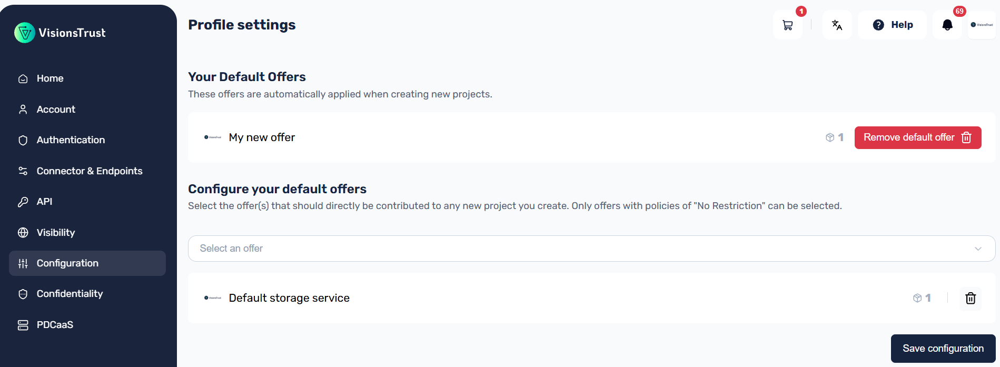

# Configuration

The "Configuration" page of your settings lets you choose your default offers. A default offer is contributed automatically to every new project you create: you do not have to add it by hand each time (see [Contributions](../application/projects/contributions.md)).

To open it, click the logo of your organisation, then "Settings", then "Configuration".

## Choose a default offer

1. Click the **Select an offer** button, then choose an offer in the list. Only the offers whose usage policies have no restriction can be selected.
2. Click the **Save configuration** button.

The message "Default offer configuration saved successfully" confirms your choice, and the offer appears in "Your Default Offers": "These offers are automatically applied when creating new projects."

If you have no offer that can be selected, the page says "No eligible offers found" and shows a **Create an offer** button: see [Create an offer](../application/registering-resources/creating-an-offer.md). An offer has no restriction when its usage policies do not limit the time period or the count.

## Remove a default offer

Click the **Remove default offer** button next to the offer. New projects will no longer include it.
