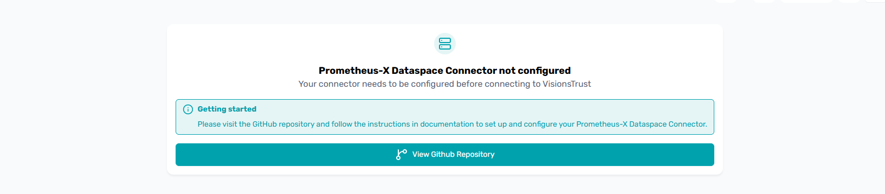
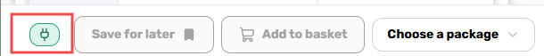
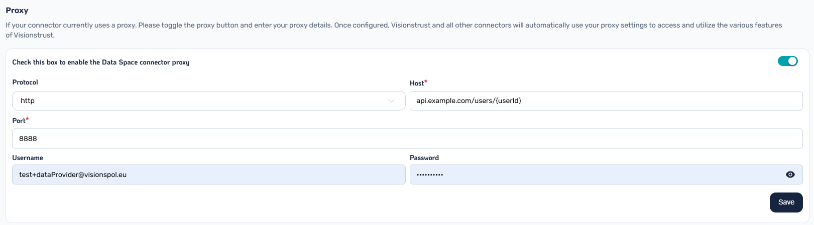

# Connector & Endpoints

The "Connector & Endpoints" page of your settings shows the connector of your organisation and its endpoints, and lets you choose the data exchange flows it supports.

To open it, click the logo of your organisation, then "Settings", then "Connector & Endpoints".

## If your connector is not configured

When no connector is configured, the page says "Prometheus-X Dataspace Connector not configured": your connector needs to be configured before connecting to VisionsTrust. The "Getting started" box asks you to follow the instructions in the documentation of the Prometheus-X Dataspace Connector. Click the **View Github Repository** button to open it. Once your connector is configured and connected, the page shows its endpoints and the data exchange flows.

## Your connector and its endpoints

When your connector is configured, the page says "Your connector is configured and connected to VisionsTrust". Its endpoints are registered on the catalogue automatically, and used during the data exchange protocols. Each one has a **Copy** button:

| Endpoint | What it is |
| --- | --- |
| Connector Configured | The address of your connector |
| Consent Export Endpoint | The endpoint used to export consents |
| Consent Import Endpoint | The endpoint used to import consents |
| Data Export Endpoint | The endpoint used to export data |
| Data Import Endpoint | The endpoint used to import data |

## Supported data exchange flows

In "Configure supported data exchange flows", choose the flows you want to support with your connector: REST, PostgreSQL, Kafka and FTP. You can also switch on "All exchange flows".

A banner shows the version of your connector: "Your connector version is ...".

1. Switch on the flows that your connector supports.
2. Click the **Save configuration** button. It is available once you have changed something.

The message "Supported data exchange flows updated successfully" confirms your choice.

The flows you select are the ones that your connector supports. On the page of an offer in the catalogue, the plug icon "Supported protocols" tells you if the offer is supported or not. It depends on the protocol type chosen in the configuration of the resource of the offer: see [Data Resources](../application/registering-resources/data-resources.md).

## Proxy

If your connector uses a proxy:

1. Switch on "Check this box to enable the Data Space connector proxy".
2. Choose the protocol (http or https), then fill in the host and the port, which are required, and the username and the password if you need them. Click the eye icon to display the password.
3. Click the **Save** button. The message "Dataspace connector proxy added successfully" confirms it.

Once the proxy is configured, VisionsTrust and all the other connectors use your proxy settings to access and use the features of VisionsTrust. Click the **Delete** button to remove your proxy settings.

