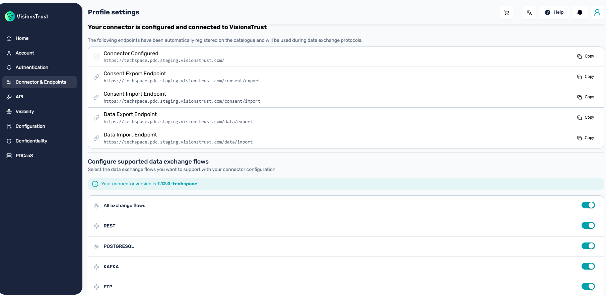

# Connector & Endpoints

The "Connector & Endpoints" page of your settings shows the connector of your organisation and its endpoints, and lets you choose the data exchange flows it supports.

To open it, click the logo of your organisation, then "Settings", then "Connector & Endpoints".

## Your connector and its endpoints

When your connector is configured, the page says "Your connector is configured and connected to VisionsTrust". Its endpoints are registered on the catalogue automatically, and used during the data exchange protocols. Each one has a **Copy** button:

| Endpoint | What it is |
| --- | --- |
| Connector Configured | The address of your connector |
| Consent Export Endpoint | The endpoint used to export consents |
| Consent Import Endpoint | The endpoint used to import consents |
| Data Export Endpoint | The endpoint used to export data |
| Data Import Endpoint | The endpoint used to import data |

## Supported data exchange flows

In "Configure supported data exchange flows", choose the flows you want to support with your connector: REST, PostgreSQL, Kafka and FTP. You can also switch on "All exchange flows".

1. Switch on the flows that your connector supports.
2. Click the **Save configuration** button. It is available once you have changed something.

The message "Supported data exchange flows updated successfully" confirms your choice.

## Proxy

If your connector uses a proxy:

1. Check the box "Check this box to enable the Data Space connector proxy".
2. Fill in the protocol, the host, the port, the username and the password.
3. Click the **Save** button.

Once the proxy is configured, VisionsTrust and all the other connectors use your proxy settings to access and use the features of VisionsTrust. Click the **Delete** button to remove your proxy settings.
