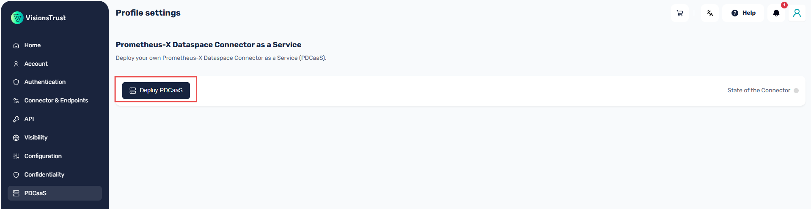
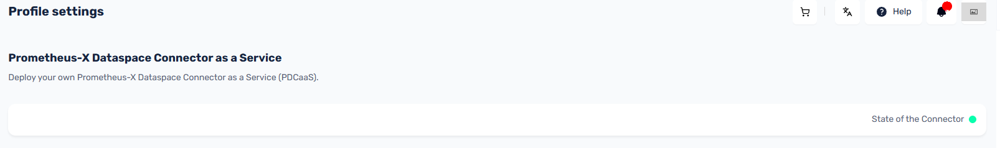

# PDCaaS

The Prometheus-X Dataspace Connector as a Service (PDCaaS) is a connector hosted by VisionsTrust for you. It lets you connect your services and data to the data space without deploying or maintaining your own Prometheus-X Dataspace Connector (PDC).

## What VisionsTrust takes care of

- The hosting of your connector
- Its dedicated domain name
- Its technical configuration
- The secure exchanges
- The updates of the connector

The PDCaaS acts as a secure intermediary between your services or APIs and the other participants of the data space.

## How it works

1. You configure your offer in VisionsTrust, with the URL of your resource (the API endpoint), the parameters it needs (the query parameters) and your credentials, for example an API key.
2. You deploy your connector with one click, from the "PDCaaS" page of your settings. VisionsTrust then creates and configures it automatically: nobody has to deploy it by hand.
3. Once your connector is deployed, it manages the exchanges between participants according to the contracts, applies the security and governance rules, and forwards the requests to your resources.

!!! warning "Your previous connector"

    If you used your own connector before the PDCaaS, do not restart it. It may overwrite or affect the configuration of your new connector.

## Deploy your PDCaaS

1. Open "Settings", then "PDCaaS".
2. Click the **Deploy PDCaaS** button.
3. Follow the state of your connector with the dot next to "State of the Connector".

You do not have to configure anything on your side before you deploy your PDCaaS: one click on the button is enough.

## The PDCaaS page

 

Open "Settings", then "PDCaaS". On the page "Prometheus-X Dataspace Connector as a Service", you deploy your own connector with one click, and you follow its state. The dot next to "State of the Connector" shows the state of your connector: green means that it has been deployed successfully.

!!! warning "Deployment cannot be undone"

    Once your PDCaaS is deployed, you cannot stop it or delete it from VisionsTrust.

## Find the address of your connector

Each participant has a dedicated address: `https://<organisation-name>.pdc.visionstrust.com`. Replace `<organisation-name>` with the name of your organisation as it appears in VisionsTrust. You find the address of your connector in "Settings", "Connector & Endpoints", and in "My Tech Space".

If needed, whitelist this address on your resources, so that the connector can access them.

## PDCaaS dashboard

Each participant has a dashboard at `https://<organisation-name>.pdc.visionstrust.com/dashboard`. Log in with your API keys. It gives you a full view of how your connector works, without complex technical access:

| Feature | Description |
| --- | --- |
| Data exchanges | The history of your data exchanges |
| Requests | The incoming and outgoing requests |
| Configuration | Check and edit the settings of the connector |
| Logs | The activity logs, to diagnose errors |
| State of the connector | The state of your connector, in real time |

## Exchange triggers

With a PDCaaS, you have access to the "Exchange Triggers" feature in VisionsTrust: it lets you start data exchanges directly from the platform. See [Exchange Triggers](../guide/exchange-triggers.md).

## Questions

**Is my connector isolated from the other participants?** Yes. Each participant has its own connector, hosted in an isolated environment, with its own database. Your data and configurations are never shared with other organisations.

**What happens if my API is temporarily unavailable?** The PDCaaS records the errors and shows them in the dashboard. Failed exchanges can be diagnosed with the logs.
